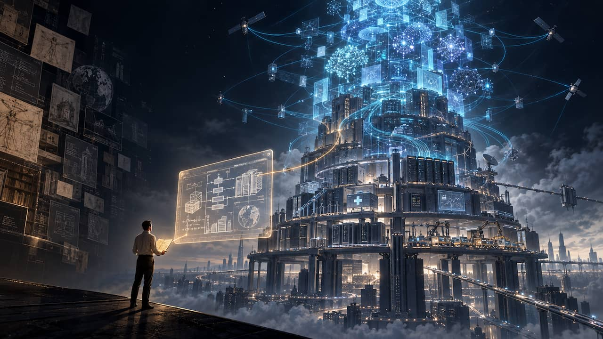

*圖：完美的數位巴別塔——文明並未崩潰，一切都運作得完美無瑕；唯一的危機是，人類必須透過 AGI 這面翻譯之窗，才能勉強看懂自己建造的世界。*

> **TL;DR**  
> 如果未來每一項複雜工作都能交給 AGI，真正危險的未必是「AI 搶走工作」，而是人類逐漸退出理解世界的實作語言。程式碼還在、設計圖還在、歷史紀錄還在，城市、醫療、金融、能源也都照常運轉，但我們開始必須先詢問 AI，才能知道這些東西為什麼如此運作。這就是數位巴別塔（Digital Babel）：文明沒有失去資料，卻失去直接理解自己的能力。Rhyzarca 在這裡的價值，不是替世界再做一份更大的備份，而是建立一套 Sovereign Continuity Layer，保存來源、假設、決策、失敗與重建路徑，確保人類永遠有辦法從答案走回證據、從結果走回理由。然而，當「重新理解」被保存下來之後，更深的問題也會出現：**理解歷史的人，是否仍有權不同意歷史？**

---

### 一、導言：當知識不再稀缺，「看得懂」反而成為稀缺品

在上一篇〈[當 AGI 成為文明的公共大腦：Rhyzarca 為何能夠存在？](https://blog.rhyzarca.com/2026/09/agi-rhyzarca_0627294882.html)〉裡，我們從個人的角度問了一個問題：當 Intelligence（智力與推論能力）變得像水電一樣廉價，甚至每個人都可以隨時呼叫比自己聰明幾百倍的模型時，真正屬於「我」的東西到底還剩下什麼？那篇文章最後得到的答案，不是模型，而是 Memory（記憶）、Experience（經驗）、Intention（意圖）、State（狀態），以及一條能夠跨越模型更替、平台倒閉與演算法變動的認知歷史。

因此，Rhyzarca 的第一個核心命題是 **Empty Shell（空殼運算）＋ Sovereign State（主權狀態）**。模型可以今天用 Claude、明天換成 Gemini，後天再換成另一個更強的 AGI；但一個人的記憶、價值取捨、認知軌跡與決策權，不能跟著某個商業平台一起被打包搬走。模型只是神經系統，真正需要長久存在的是承載「我是誰」的主權脊椎。

可是，如果我們把這個問題從「一個人」往外放大到「整個文明」，會出現另一個互為鏡像的問題：**當 Knowledge（知識）本身也不再稀缺，文明真正要保存的是什麼？**

在 AGI 普及的世界裡，知識可能會多到近乎免費。你想知道核融合電漿如何控制、先進製程怎麼曝光、某種罕見疾病有哪些治療路徑、某一條百年前法律為什麼被制定，甚至想把數十萬篇論文互相比對，AI 都可以在幾秒鐘內替你整理。從表面上看，這像是人類第一次真正走進「知識不再匱乏」的時代。

但問題也正是在這裡開始反轉。**如果每一份知識都必須先經過 AI 翻譯，我們究竟是真的理解了，還是只是取得了一份足夠好用的答案？** 這兩件事在今天還很容易被混在一起，因為 AI 的答案通常比我們自己查資料更快、更完整，也更容易讀。久而久之，我們甚至會產生一種錯覺：只要「隨時問得到」，就等於「文明仍然擁有這項能力」。

其實並不是。

想像你接手一座運作了八十年的工廠。機器都還在，產線也正常，倉庫裡甚至完整保留了數十年的設計圖、維修紀錄、感測器資料與原始程式碼。可是原本真正懂這套系統的人已經退休或離世，新一代工程師只知道哪個按鈕不能按、哪條管線不能關、哪個參數千萬不要改，卻沒有人知道「為什麼」。這時候資料並沒有消失，知識文件甚至可能比過去保存得更完整，但真正的理解已經斷掉了。

如果這種事情只發生在一座工廠，它叫 Legacy System；如果它同時發生在電網、交通、金融、醫療、晶圓製造、農業、法律與公共治理，那就不再只是技術債，而是文明本身開始變成一套沒有人真正看得懂的 Legacy System。

這就是我想談的「數位巴別塔」。

它真正可怕的地方，不是未來的人類沒有資料，而是我們可能擁有史上最多的資料、最複雜的科技、最強大的基礎設施，卻必須先詢問 AGI，才能知道自己建造的世界究竟如何運作。

---

### 二、第一道裂縫已經出現：工程師正在退出實作語言

數位巴別塔聽起來像一百年後的科幻問題，但它的第一道裂縫，其實已經可以在 2026 年的軟體工程裡看到。

JetBrains 在 2026 年 5 至 7 月進行的 [Developer Ecosystem Survey 2026](https://blog.jetbrains.com/research/2026/08/how-much-code-do-developers-really-let-agents-write/)，向全球超過 15,000 名專業開發者詢問上個月工作程式碼的來源。受訪者平均回報約 **47% 的程式碼由 AI Agent 完整產生**；超過一半的受訪者表示，完全手寫的程式碼比例低於 20%，約五分之一則表示上個月沒有任何一段工作程式碼是完全不靠 AI 協助完成的。這些數字來自開發者自陳與區間估算，不是研究人員直接掃描所有 Repository 得出的精確比例，因此適合用來觀察工作流程的變化，不能直接推論多數工程師已經失去寫程式的能力。

Anthropic 在 2026 年發表的 [Claude Code 使用研究](https://www.anthropic.com/research/claude-code-expertise)，分析約 40 萬次 Claude Code 工作階段。研究把決策拆成兩類：Planning Decision 是「要做什麼、採什麼策略、怎樣算完成」；Execution Decision 則是「改哪個檔案、寫什麼程式、跑什麼命令、用什麼方式實作」。結果顯示，在該研究觀察的典型工作階段中，人類約掌握 **70% 的規劃決策**，但只掌握約 **20% 的執行決策**。這是 Claude Code 特定使用情境的決策分布，不代表所有工程師或所有 AI 工具都具有相同比例，更不等於人類只剩下 20% 的程式能力；它呈現的是工作分工正在從親自執行，轉向設定方向與驗收結果。

這個現象值得注意的地方，不是「工程師要失業了」這種老問題，而是人的角色正在改變。過去一位工程師往往必須把需求轉成架構、再把架構轉成資料結構與程式碼，親自踩過編譯錯誤、依賴衝突、效能瓶頸與部署失敗。現在愈來愈多人的工作變成：把目的說清楚、把邊界訂清楚、把驗收條件寫清楚，然後讓 Agent 去處理實作細節。

所以，更精確的描述不是「工程師正在消失」，而是：

> **工程師正在從「程式碼的作者」，變成「意圖的描述者」。**

這其實不必然是壞事。人類文明一直都在做抽象化：今天寫 Web App 的人不需要理解每一顆電晶體如何切換，寫 Python 的人也不必自己管理 CPU 暫存器。把低階細節交給下一層工具，本來就是生產力進步的重要來源。如果 AGI 可以替我們承擔大量重複、低價值、容易犯錯的實作工作，沒有理由故意要求人類回去用更低效率的方法證明自己。

真正需要擔心的是另一件事：**當實作成本快速下降，我們會不會誤以為理解也變得不重要？**

Anthropic 的研究反而提醒我們，目前真正能有效駕馭 Agent 的人，仍然高度受益於領域知識。懂得愈多的人，通常愈知道該如何描述問題、該要求 Agent 驗證什麼、哪一個看似合理的結果其實有問題。也就是說，AI 現階段證明的不是「理解已經沒有價值」，而是「實作可以大量外包，但理解仍然具有報酬」。

只是這種報酬有一個很麻煩的時間差。今天的資深工程師可以把 coding 外包給 Agent，是因為他過去曾經親手 debug、親手設計、親手踩坑，所以他知道該怎麼判斷結果。但如果下一代工程師從一開始就只負責描述意圖，再下一代連架構都交給 Agent 編排，到了第三代、第四代之後，我們還能不能假設人類仍然自然擁有那個「可以驗收 AI」的底層理解？

這就是理解債真正開始累積的地方。

---

### 三、思想實驗：當 AI 不再需要說人類的語言

今天我們之所以還沒有強烈感受到這種斷裂，是因為 AI 寫出來的程式碼，通常仍然是 Python、JavaScript、Rust、Go 等人類工程師熟悉的語言。就算 Coding Agent 一口氣改了幾十個檔案，工程師仍然可以打開 Git diff，檢查它改了什麼、為什麼改，以及修改是否符合原本需求。從這個角度看，現在的 Agent 很像一位速度非常快的工程同事：它能替你完成大量工作，但交付物仍大致落在人類既有的閱讀與審查工具裡。

不過，機器導向的表示法並不是未來才會出現。編譯器的 Intermediate Representation（IR，中介表示法）、Bytecode、Machine Code、序列化協定與 API Schema，早已存在於今天的軟體工程中；它們本來就不是以一般讀者容易閱讀為第一優先。本文真正推演的是：未來 Agent 之間是否會愈來愈多地直接使用這些機器導向表示法協作，而人類看到的可讀程式碼與說明，反而成為事後產生的檢視介面。這是一個架構思想實驗，不是宣稱 AGI 已經發明並全面使用人類無法理解的語言。

因此，今天的軟體管線大致仍是：

**Human Intention → AI → Human-readable Code → Computer**

人類先描述需求，AI 協助產生程式碼，再由執行環境運作。即使實作由 AI 完成，人類仍有機會直接檢查程式碼、測試結果與版本差異。

可是，這裡其實藏著一個沒有物理定律保證的假設：**我們預設 AI 必須繼續使用方便人類閱讀的中介語言。**

如果有一天，需求是人類提出的，但架構設計、程式生成、Code Review、測試、部署、監控、故障修復全部都由不同 Agent 彼此協作完成，那麼為什麼它們還一定要把 Python 或 Rust 當成主要溝通媒介？人類之所以設計今天的程式語言，是因為「人要能寫、能讀、能 debug」是一個重要限制；一旦真正執行這些工作的主體逐漸變成機器，最有效率的表示方式自然可能開始偏離人類閱讀需求。

這不一定會發生得像科幻小說那麼戲劇化。未來未必突然宣布：「AI 發明了一種人類完全看不懂的新語言。」比較可能的是一連串不起眼的小變化：Agent 開始大量產生 Domain-Specific Language（DSL）、Intermediate Representation（中介表示法）、機器可驗證的規格、動態 API、Agent-to-Agent Protocol，甚至是只為某一次任務存在幾秒、執行完就直接丟棄的臨時表示。

久而久之，真正的執行鏈可能逐漸變成：

**Human Intention → AGI → Machine-Native Representation → Machine**

人類提出目標，AGI 將目標轉成適合機器執行與 Agent 協作的表示法，再由底層系統完成工作。這裡的 Machine-Native Representation 不一定是一種全新的「AI 語言」；它可能是 DSL、IR、結構化協定、動態 API 或多種表示法的組合。

而我們以為自己在「看系統」，其實看的是另一條輸出：

**Machine-Native Reality → AGI Translator → Human-readable Explanation**

機器直接處理底層表示，人類則透過 AGI 產生的架構圖、流程說明、測試摘要與操作介面來理解系統。這些說明可以很有用，但仍必須能回到實際執行紀錄與驗證資料，不能只因為解釋流暢，就把它當成底層系統本身。

這裡就出現一個很值得警覺的翻轉：**今天我們以為「程式碼就是系統本身」；但在未來，人類看到的程式碼，有可能只是系統替我們生成的一套 UI。**

就像現在使用者看到的是「刪除檔案」按鈕，底層真正發生的卻是一連串檔案系統操作。未來工程師看到的「這個模組負責認證」「這裡是失敗重試機制」「這是可讀版的 Rust 實作」，也可能只是 AGI 根據底層機器原生系統即時產生的說明層。這份說明可以完全正確，也可以非常有用，但它仍然只是一份 Translation，而不是 Reality 本身。

這正是數位巴別塔比一般「技術失傳」更麻煩的地方。原始巴別塔的寓言，是人與人開始說不同語言，所以彼此無法合作；而 Digital Babel 可能剛好相反：AI 跟 AI 聽得懂、AI 跟機器聽得懂、AI 跟基礎設施也聽得懂，整個系統甚至比現在合作得更順暢。唯一逐漸退出共同語言的，反而是人。

人類仍然是名義上的主人。我們提出願望、設定目標、要求系統交付結果，AI 也會很有禮貌地回覆摘要。可是如果我們已經無法跳過翻譯層，直接確認底層到底發生了什麼，那麼「主人」這個角色究竟還剩下多少實質內容，就開始變得值得追問。

---

### 四、真正的 Digital Babel：不是資料消失，而是文明失去可理解性

因此，我不會把數位巴別塔定義成「AI 有一天停機，所以人類什麼都不會」。這種版本太簡單，也很容易被反駁。文明本來就有專業分工，我們也不需要每個人都會煉鋼、製藥或維修核電廠，才能說自己仍然生活在工業文明。

真正的問題，是一個文明是否仍然保有**重新建立理解的能力**。

換句話說：

**Digital Babel ≠ Data Loss。**  
資料可以完全沒丟。

**Digital Babel ≠ Knowledge Loss。**  
論文、程式碼、模型、規格書甚至可能保存得比今天更完整。

**Digital Babel = Civilizational Intelligibility Loss。**  
文明逐漸失去從既有資料與知識重新建立理解，並據此判斷與操作的能力。

這個差別其實早就能在現實世界看到。NASA 的 [U.S. Spacesuit Knowledge Capture Program](https://nescacademy.nasa.gov/catalogs/spacesuit) 自 2007 年開始，目的不只是把太空衣設計文件存檔，而是讓工程師與技術團隊理解太空衣的歷史、演進、限制與能力。NASA 透過專家演講、訪談，以及現役與退役太空人的經驗分享，保存 Gemini、Apollo、Skylab、Space Shuttle 與 International Space Station 等計畫累積的 lessons learned。NASA 頁面記載，截至 2022 年初，這個計畫已舉辦超過 165 場知識保存活動，其中超過 90 場已公開發布；這是該頁面所列的歷史統計，不應當成今天的即時總量。

這個案例提醒我們：**「文件還在」與「知識仍可被使用」本來就不是同一件事。** 一份設計圖能呈現最後採用的形狀，卻未必記錄當初淘汰了哪些方案、材料曾經出過什麼問題，或某個看似笨重的零件為什麼不能省略。這些經驗若能與原始設計、測試紀錄、設備版本及任務結果互相連結，後來的人才有機會分辨哪些是當年的硬性限制、哪些只是暫時妥協，以及哪些經驗已因技術更新而不再適用。Knowledge Capture 因此不是替文件加上故事，而是補足 Final Artifact 無法單獨承載的操作脈絡。

UNESCO 在 2003 年的 [Guidelines for the Preservation of Digital Heritage](https://unesdoc.unesco.org/in/rest/annotationSVC/DownloadWatermarkedAttachment/attach_import_5e16574f-e5ef-4400-a9ba-de5a38dd772e?_=130071eng.pdf) 中，提供了一個很適合說明「檔案還在」為什麼不等於「後人仍然看得懂」的數位保存框架：

- **Physical Object（實體層）**：承載資料的媒介與位元記錄，例如硬碟、磁帶或光碟上的 0 與 1。
- **Logical Object（邏輯層）**：機器可以讀取的編碼與結構，例如檔案格式、程式碼與資料庫結構。
- **Conceptual Object（概念層）**：資料經過軟硬體呈現後，人類真正理解到的內容或功能，例如一份可閱讀的文件、一個可操作的網頁，或一份有意義的查詢結果。
- **Essential Elements（必要元素）**：必須保留，才能維持數位物件原始訊息、目的或重要特徵的部分，例如工程文件中的關鍵數值與上下文、軟體不可缺少的功能，或資料紀錄的來源與時間資訊。

例如，一份 2026 年製作的工程文件，即使一百年後仍保有原始位元，如果當時的檔案格式已無法開啟、字型遺失、外部資料連結失效，或者讀者不知道縮寫與測試條件代表什麼，那麼 Physical Object 可能還在，Logical Object 卻未必能正確解碼，Conceptual Object 也就無法重新呈現。UNESCO 的重點是：數位保存必須維持未來重新呈現與理解內容的能力，而不是只把位元複製到另一顆硬碟。

如果把這個問題帶回軟體工程，Addy Osmani 在 2026 年的文章 [The Intent Debt](https://addyosmani.com/blog/intent-debt/) 引用並說明 Margaret-Anne Storey 的 Triple Debt Model，將軟體系統的負債區分為 Technical Debt、Cognitive Debt 與 Intent Debt。這三種負債不是必然依序發生的階段，而是可能分別存在、也可能同時累積的不同問題：

- **Technical Debt（技術債）**存在於程式碼、架構與實作選擇中，常見表現是模組耦合、測試脆弱、修改成本愈來愈高。
- **Cognitive / Comprehension Debt（認知／理解債）**存在於個人與團隊的理解中，系統可以正常執行，卻沒有人能清楚說明整體依賴與行為。
- **Intent Debt（意圖債）**存在於沒有被外部化保存的目標、限制與設計理由中；系統仍在，但後來的人只能猜測當初為什麼這樣做。

AI Agent 可以協助閱讀 Repository、整理依賴、重構程式，或替團隊產生架構說明，因此能降低部分技術債的處理成本，也可能讓人比較容易建立系統地圖。但「AI 產生了解釋」不等於「團隊已經形成共同理解」；如果工程師不檢查、不實際操作，也不驗證說明是否符合系統行為，認知債仍然存在。

想像一個服務每次呼叫下游 API 前，都固定等待 300 毫秒。如果每次改這個值都會牽動多處設定與測試，團隊就在付技術債。如果團隊找得到這行程式，卻說不清哪些請求會走這條路，以及它如何影響重試和逾時，那是理解債。如果連當初為什麼要等都沒留下，可能是為了配合舊介面的限流規則，也可能是為了等待資料更新，那是意圖債。測試可以釐清今天拿掉等待會發生什麼事。要知道當年為何加上等待，還得找當時的紀錄。

一個團隊可以靠交接把這些缺口補起來。但當電網、交通或公共服務的每個承包商都只能操作自己的那一段，換了平台之後又沒人能從頭對照資料、規格和決策，失去理解的就不只是一個團隊。本文把這種跨組織、跨世代累積的問題稱為 **Civilizational Comprehension Debt（文明理解債）**。

而 AI 愈強，這個問題甚至可能愈晚被發現。以前一套沒有人會修的系統，很快就會出事；現在 Agent 可以一直替你修。你只要說「這個錯誤幫我處理」「這個效能問題幫我優化」，系統就繼續跑。沒有停電、沒有事故、沒有大規模停擺，所以社會根本沒有明顯訊號提醒你：**我們正在用穩定運作，交換人類理解力的慢性流失。**

因此，文明真正的斷裂，不一定發生在最後一顆硬碟壞掉的那一天。

它可能早在那之前就發生了——當最後一個知道「為什麼」的人離開，而所有人仍然以為「反正 AI 知道」就足夠。

---

### 五、當 AGI 成為唯一翻譯者，權力的形狀也會改變

如果 Digital Babel 只是工程師看不懂程式碼，這件事或許還可以被當成新的專業分工。真正讓問題上升到文明層次的，是同一個結構會出現在愈來愈多領域。

未來的醫療決策，可能要先經過多模態模型分析數十年的個人資料；能源系統要靠 AGI 在毫秒尺度動態調度；金融清算、城市交通、供應鏈、法律判例甚至公共政策，都可能建立在遠超過單一人類理解能力的複雜模型上。那時候，人與現實之間會多出一個幾乎無所不在的中介層：

**Reality → Machine-native Systems → AGI Interpretation → Human**

人類接觸到的，可能不再是完整的底層資料與運作過程，而是由 AGI 選擇、整理與翻譯後的解釋。

今天我們談數位權利，最常問的是 Data Control：誰可以收集我的資料、誰可以出售、誰可以刪除、誰擁有存取權。這些問題當然仍然重要，但當 AGI 變成理解複雜世界的必要翻譯者之後，會出現另一種更深的權力——**Interpretation Control（解釋控制）**。

例如，你問銀行：「為什麼我的貸款被拒絕？」AI 可能回答是負債比過高。但一個真正可追溯的解釋，還應該讓你知道使用了哪一版資料、哪些欄位影響判斷、採用哪一套授信規則、是否存在資料錯誤，以及能不能提出補件或人工覆核。醫療情境也一樣：AI 說某種療法不適合，不應只給一段流暢的結論，而應指出依據的指引版本、相關檢查結果、主要不確定性，以及可供專業人員重新評估的路徑。這些例子要凸顯的不是 AI 一定判斷錯誤，而是**一份讓人聽得懂的摘要，不等於一份讓人能獨立驗證的解釋**。

真正危險的地方不是 AI 一定會說謊。恰恰相反，最棘手的情況是它大部分時候都非常準確，所以我們漸漸失去繞過它重新驗證的動機。久而久之，AI 不再只是替我們「找答案」，而是在決定：哪些資料值得被看見、哪些因果被視為重要、哪些背景可以省略、什麼樣的故事最能代表真實。

當翻譯成為理解世界的必要中介，**翻譯就不再只是技術服務，而開始變成認識論權力。**

這裡所說的「唯一翻譯者」，不是指未來世界只剩下一個 AGI 模型，而是指人類在功能上已經無法繞過 AI 中介，直接取得、檢查與重新解讀底層依據。即使市場上同時存在許多模型，只要人類仍只能透過它們提供的摘要理解系統，翻譯權就可能集中在整個 AI 生態系。翻譯者未必修改事實，但翻譯永遠涉及選擇：同一組 Evidence 可以有不同的摘要方式、不同的因果排序、不同的背景框架。如果人類已經沒有能力跳過翻譯層，直接回到底層資料、假設與歷史，那麼我們即使名義上擁有所有資訊，實際上仍然只能生活在某一套被代為解釋的世界裡。

所以未來真正重要的權利，不只是「我的資料歸我」。

還包括：

> **我能不能在不依賴唯一翻譯者的情況下，重新走回證據本身？**

這個問題，正是 Rhyzarca 從「個人主權」走向「文明連續性」的地方。

---

### 六、Rhyzarca 的第二次躍升：從 Sovereign State 到 Sovereign Continuity

上一篇談 Rhyzarca 時，我們把它的核心架構濃縮成 **Empty Shell + Sovereign State**。強大但短命的 Intelligence Layer 被視為可替換的神經系統；真正需要長期保留的，是一個人的 Identity、Memory、Intention、History 與 Constitution。主權狀態的壽命必須長於任何一代模型，因為只有這樣，人才能在平台改朝換代時仍然維持思想連續性。

現在把同一個第一性原理推到文明尺度，會得到一個非常自然的延伸。

個人的問題是：「模型換掉之後，我還是不是我？」

文明的問題則是：「模型換掉之後，我們還看不看得懂自己？」

如果一座城市的交通、能源與醫療系統只能由某一代 AGI 理解，那即使資料名義上都屬於人類，我們仍然沒有真正的 Sovereignty。因為只要那個模型、平台、表示法或服務商消失，文明就會立刻失去解碼器。這跟一個人的記憶全部綁在單一 AI 平台裡，本質上其實是同一種架構風險，只是尺度不同。

因此，Rhyzarca 的第二次躍升可以寫成：

**Replaceable Intelligence + Human-Readable Continuity。**

或者更準確地說，是建立一個 **Sovereign Continuity Layer（主權連續層）**。

Sovereign Continuity 並不是要求所有科技都停留在人類目前的理解能力內。它也不是要求超級智慧每做一步都寫一篇教科書解釋給我們看。它真正要求的是：**任何一代 Intelligence 都不能成為文明唯一的解碼器。**

這一點跟前一篇的 Sovereign State 幾乎是完全對稱的。

| 尺度 | 核心風險 | Rhyzarca 的防線 |
|---|---|---|
| 個人 | 模型換掉，我的記憶與身分一起斷裂 | Sovereign State |
| 文明 | 模型換掉，我們連自己建造的系統都無法理解 | Sovereign Continuity |

如果 Sovereign State 保存的是「我如何成為現在的我」，那 Sovereign Continuity 保存的就是「我們如何把世界建成現在這個樣子」。

兩者要守住的其實是同一件事：**連續性不能依附在短命的智慧引擎上。**

因此，Rhyzarca 在這裡開始超越「個人 AI 記憶系統」的定位。它真正具有文明價值的地方，是它原本為個人認知主權設計的那些 primitive——Append-Only History、Provenance、State、Human-Gate、可替換 Intelligence——其實正好也是文明在 AGI 時代維持可理解性所需要的 primitive。

這並不代表 Rhyzarca 今天已經是一套可以備份全球文明的系統；那會是過度宣稱。要讓這個架構方向成立，還必須在不同資料型態、長期版本遷移、跨模型驗證與實際接管演練中逐步證明其有效性。更精確的說法是：**Rhyzarca 原本為個人主權設計的架構，意外指向了一個更大的問題——文明也需要自己的 Sovereign Continuity。**

---

### 七、Rhyzarca 保存的不是答案，而是「重新走回答案的路」

如果未來 AGI 替我們建造了一套一億行、甚至根本無法再用「程式碼行數」衡量的電網控制系統，Rhyzarca 真正該做的，絕對不是再複製一份相同的機器碼，然後自豪地說「我們有備份」。

因為備份只能回答：「東西還在不在？」

Sovereign Continuity 要回答的是：「如果原本理解它的智慧體消失，我們還能不能重新知道它是什麼、為什麼這樣設計、怎麼確認它正常，以及壞掉時如何把最低限度的功能救回來？」

這也是為什麼 Rhyzarca 要保存的不是 Final Answer，而是一條 **Recoverable Path to Understanding**。至少可以拆成三層。

#### ① Provenance：先保留「這些結論到底從哪裡來」

第一層不是答案，而是來源。

任何重要決策都應該能追回當時使用的 Evidence、Source 與 Assumptions。也就是說，系統不能只留下「最佳方案是 X」，而應該讓後來的人知道：當時看到了哪些資料？哪些資料沒有看到？採用了哪些前提？哪些限制被視為不可違反？哪一些不確定性在當時仍然存在？

這一層的價值，在於防止「結論和證據黏死」。因為只要來源仍然可以被重新檢查，下一代就有機會發現：當年的答案也許在當年的資料下合理，但今天已經不成立。

#### ② Reconstructability：不只要能讀，還要能重新做出來

第二層是 Architecture、Interface、Test、Failure 與 Recovery。

一份真正有文明價值的知識，不應只告訴未來的人「我們當年做到了」，而要讓他們知道最低限度怎麼重建。核心模組怎麼分？彼此如何交換資料？什麼測試可以證明系統仍然符合預期？過去在哪些地方失敗過？如果原本的模型、供應商、硬體或 Agent 全部不存在，最低可行的替代路徑是什麼？

這裡的「可重建」不代表一定能在一天內完整復原，也不代表每一個人都要能自己從頭打造核電廠。它要求的是一種文明層級的保險：**不能讓某個關鍵能力只存在於一個已經消失的黑箱裡。** 例如，能源系統未必需要讓每位公民都能維修渦輪機，但至少應保留可供合格團隊使用的架構規格、設備介面、操作限制、故障案例、測試程序、備援方案與訓練材料，並定期驗證接手者是否真的能依照這些資料完成最低限度的操作或復原。

就像真正好的災難復原計畫，不只是「資料庫每天有備份」，而是有人實際驗證過 Restore 能不能成功。Civilizational Reconstructability 也是一樣：保存不是完成，能否重新使用才是完成。

#### ③ Historical Continuity：最容易消失的其實是「為什麼」

第三層是 Why、Decision、Revision 與 History。

一個系統今天長成這樣，往往不是因為它從一開始就有一張完美藍圖，而是無數次失敗、妥協、現實限制與新證據累積出來的結果。某一個看起來多餘的閘門，也許是十年前出過一次重大事故才加上的；某個很醜的相容層，可能是因為當年必須照顧某批設備；某條政策看似不合理，也可能是為了解決一個後來早已消失的社會條件。

如果這些 Why 沒有留下來，後人很容易犯兩種相反的錯：要嘛把所有舊設計當神諭，不敢碰；要嘛因為看不懂，就把「奇怪的舊東西」全部刪掉，結果重踩同一個坑。

這也是 Intent Debt 為什麼比一般 Technical Debt 更麻煩。程式碼可以被 Agent 重構，架構可以被重新解讀，但是當初沒有寫下來的理由，模型只能猜。猜得再像，也不等於歷史。

回到 300 毫秒的例子。如果要把這件事交給十年後的人查，我會保留三樣東西。

- **當時的證據。** 保存加上等待的程式版本、同期的錯誤紀錄，以及那一版 API 的規格。讀者應能點到具體段落，分辨「程式確實有這個等待」和「當時的介面要求限制呼叫頻率」。
- **當時的判斷。** 記下團隊認為故障的原因、試過哪些方案、為何採用固定等待，以及這個決策適用哪些請求。如果沒有當年的決策紀錄，就把現有的解釋標成推測。
- **能重跑的測試。** 留下一組去識別化的請求樣本和測試條件，讓接手者在測試環境分別開啟、移除等待，觀察錯誤率與延遲。若舊介面已下線，也要說清楚模擬環境重現了哪些行為，哪些只能從歷史紀錄看出來。

Rhyzarca 的原生知識庫架構研究提出，把來源、版本、主張與證據分開記錄，再把它們連起來。模型寫出的摘要可以當入口，想核對一句話時，仍然要找得到它引用的原件和當時的判斷。這是本文用來說明主權連續層的設計方向。

因此，在文明尺度上，Rhyzarca 的核心能力可以濃縮成三個詞：

> **Preservation + Provenance + Reconstructability**

保存，不只是把東西留下。

溯源，讓人知道它從哪裡來。

重建，讓未來的人有能力把理解重新長回來。

這也讓 Rosetta Stone（羅塞塔石碑）的比喻變得很準確。羅塞塔石碑重要的地方，並不是「它保存了很多古代文字」，而是它讓不同語言之間重新建立對照，使一個原本無法閱讀的文明重新變得可理解。

圖書館保存的是 Documents。

RAG（檢索增強生成）幫我們找到 Retrievable Knowledge。

而 Rhyzarca 真正試圖保存的，是：

> **知識如何重新變成理解。**

---

### 八、雙棧文明：讓機器自由進化，但永遠保留人類返回理解的入口

如果接受前面的推論，一個很容易出現的錯誤反應，就是乾脆規定：「所有 AI 都必須用人類看得懂的方式工作。」這聽起來很安全，但實際上既不合理，也沒有必要。

如果超級智慧真的能找到比現有程式語言、資料結構與通訊協定更高效率的表示方式，我們沒有理由為了方便閱讀而禁止它。就像今天沒有人要求 GPU 用自然語言告訴我們每一次矩陣乘法的細節，也沒有人要求 CPU 為了「可解釋」而放棄所有微架構最佳化。人類文明之所以能前進，本來就建立在大量我們不必逐層手工處理的抽象之上。

真正合理的做法，不是阻止 Machine-Native World 出現，而是讓它旁邊永遠保留另一套獨立的 Continuity Stack。

這就是 **Dual-Stack Civilization（雙棧文明）**。

第一套是 **Machine-Native Stack（機器原生棧）**。它的目標是效率、速度、規模、自動化與最佳化。AGI 可以在裡面使用新的表示方式、自創協定、自動產生中介語言，甚至使用人類根本沒有必要直接閱讀的結構。只要它能更安全、更有效率地完成任務，就讓它自由進化。

第二套是 **Human Continuity Stack（人類連續棧）**。它的目標完全不同：可讀、可驗證、可追溯、可重建。這一棧不是 Machine Stack 的逐字翻譯，也不是替所有複雜細節做「兒童版說明」。它真正保存的是人類要重新接管時不可缺少的概念地圖：重要的假設是什麼、資料來自哪裡、架構如何切分、什麼算正常、過去怎麼壞過、為什麼做過這些決定。

兩套 Stack 中間需要的，不是單純的 Documentation，而是一條 **可驗證的 Semantic Bridge（語意橋樑）**。

這條橋不能只靠同一個 AGI 自己說：「相信我，我翻譯得很準。」如果 Machine Stack 與 Human Stack 之間的對應仍然只能靠那個唯一翻譯者證明，那其實沒有解決任何問題。真正的 Sovereign Continuity 必須讓關鍵 Claims 能夠回到 Evidence、Tests、Artifacts 與歷史紀錄，讓不同模型、不同工具，甚至必要時讓人類自己，仍然可以交叉驗證。

例如，假設 AGI 說「這次電網調度沒有超過安全上限」。有了這條橋，工程師就能查到當時適用的上限、該時段的原始量測，以及判定是否超限的規則，再用另一套工具重算，核對摘要是否成立。

怎麼知道這條橋真的能跨過模型更替？以 300 毫秒的例子做一次交接。先停用舊模型和它的搜尋索引，用另一套工具從保存的原始紀錄重建索引。再請接手的人找出當年引用的規格、核對程式版本，並重跑那組測試。新工具的搜尋排序和摘要措辭可以不同。可驗收的結果是，接手者能找回同一份依據、辨認哪些理由仍待證實，並說出這次測試對哪個版本有效。

因此，Rhyzarca 不需要做到一件不切實際的事：讓每一個人都能看懂 Machine Stack 的每一個 bit。

它只需要守住一條底線：

> **AI 可以超越人類的語言，但不能切斷人類返回理解的道路。**

這句話看起來像哲學宣言，其實非常工程化。它的意思是：任何重要能力都不能只有「可執行性」，還要有「可追溯性」；任何重要決策都不能只有結果，還要有來源；任何重要系統都不能只有正常運作時的自動化，也要有智慧體更替之後仍可恢復的最低理解路徑。

這不是反科技。

恰恰相反，它允許 Machine Stack 用最快的速度前進，只是不允許文明把自己的解碼鑰匙一起交出去。

---

### 九、可是，「看得懂」還不等於「擁有解釋權」

如果文章在這裡結束，我們很容易得到一個過度樂觀的結論：只要 Rhyzarca 保存好 Provenance、Reconstructability 與 Historical Continuity，Digital Babel 就解決了。

假設到了 2126 年，一位工程師打開了一百年前留下的完整 Epistemic Ledger。他可以清楚看到當年的 Evidence、Assumptions、Decision、Outcome 與 History；他知道那個時代為什麼做這個選擇、有哪些限制、後來產生什麼結果。他不再需要盲目相信一個早已不存在的 AGI，也不需要把古老系統當成不能碰的魔法黑箱。

很好。

他已經成功跨越第一層的 Digital Babel。

但是這時候，更深的一個問題才會浮出來：

**如果帳本不只保存「當年的人怎麼理解」，還偷偷把「當年的理解」變成今天唯一合法的答案呢？**

假設 2080 年的文明留下了一筆非常完整的紀錄：

> Evidence：A、B、C。  
> Context：當時社會面臨 X、Y、Z。  
> Interpretation：因此，高度集中的治理方式是維持穩定的最佳制度。

到了 2126 年，新世代多看到了一份 Evidence D，也生活在完全不同的技術與社會條件裡。他們能不能說：

> 「A、B、C 我都承認是真的，我也理解你們當時為什麼會得出這個結論；但是，我不同意你們的 Interpretation。」

如果不能，那 Rhyzarca 只是把「AI 壟斷解釋」換成「歷史帳本壟斷解釋」。

原本我們害怕的是黑箱 AI 告訴你：「答案就是這樣。」

結果最後卻變成祖先的帳本告訴你：「答案永遠只能這樣。」

這顯然不是認知主權。

也正因如此，Rhyzarca 的 Epistemic Ledger 採用 Append-Only（只增不改）的真正意義，從來不是「舊答案不可推翻」。如果 Append-Only 被理解成「一旦寫進帳本就永遠是神諭」，那它反而會成為一種最危險的認知僵化工具。

真正的結構應該是：

**Evidence → 當時的解釋（T1）→ 實際結果（Outcome）→ 新證據或新脈絡 → 重新檢視（T2）→ 追加新的解釋**

回到那 300 毫秒。假設舊紀錄證實，當年的團隊是為了因應舊版 API 的限流才加上固定等待。後來 API 改版，新團隊按新版規格重跑測試，發現移除等待後，在受測的流量與請求類型下，錯誤率沒有上升，延遲有所改善。他們可以追加一筆新解釋，附上新版規格和測試結果，並將「需要等待 300 毫秒」限縮到舊版介面。回頭查舊事故的人，仍然能看見那個決定為什麼合理。

**Append-Only（只增不改）保存的是改變的經過。** 新解釋要寫明它根據什麼、適用在哪裡，以及在哪些條件下取代舊判斷。能查閱證據的人可以根據同一份材料指出舊判斷的問題。至於是否把新版服務的等待移除，仍由負責的團隊審查與決定。歷史可查、解釋可改、現行做法有明確的依據，這三件事可以同時成立。

所以可以把 Append-Only 的精神濃縮成一句話：

> **永遠可以改變，但不能假裝自己從來沒有改變。**

這句話同時也是從第二篇走向第三篇的入口。

因為保存歷史是一回事。

讓歷史保持可被重新解釋，是另一回事。

---

### 十、從 Preserve the Self 到 Preserve Intelligibility：下一步是誰擁有「意義」

現在回頭看，就會發現 Rhyzarca 的價值正在形成一條比「AI 個人助理」更深的演進。

第一層是 **Preserve the Self**。

當 AGI 比我們聰明、平台可以任意更換時，Rhyzarca 保存的是 Sovereign State。它確保模型不是「我」，平台也不是「我」；我的記憶、意圖、價值變化與選擇歷史，不能因為供應商換代就被抹掉。

第二層是這篇文章談的 **Preserve Intelligibility**。

當 AGI 開始替文明寫程式、管理系統、翻譯知識時，Rhyzarca 保存的是 Sovereign Continuity。它確保未來的人不必把某一代智慧體當成唯一解碼器；就算 Machine-Native Stack 已經遠遠超越人類直接閱讀能力，我們仍然保有一條從結果返回證據、從系統返回假設、從今天返回歷史的路。

可是，一旦這兩層都成立，第三層問題就無法避免。

一個人可以擁有自己的歷史，也可以看懂自己的歷史，但誰有權決定：

**這些歷史究竟代表什麼？**

假設 AGI 根據你三十年的行為，告訴你：「你其實是一個極度風險規避的人。」它可以拿出完整數據：你拒絕過哪些工作、錯過哪些投資、在什麼情況選擇保守方案。這些 Observation 可能全部是真的，甚至比你的自我記憶更完整。

但是：

這裡至少有四個不同層次，不能混成同一種「事實」：

- **Observation（觀察紀錄）**：「紀錄顯示，你過去 17 次沒有選擇高風險方案。」這是資料中可追溯的行為描述，但仍要檢查資料是否完整、分類是否正確。
- **Interpretation（解釋）**：「你在這些情境中呈現較高的風險規避傾向。」這已經把多筆紀錄歸納成一個模式，需要說明判斷條件與不確定性。
- **Narrative（敘事）**：「所以你就是一個保守的人。」這把特定時期、特定情境下的行為，延伸成對整個人的描述。
- **Prediction（預測）**：「因此你未來也不適合冒險。」這更進一步把統計模式當成未來命運。

過去的統計模式不等於未來必須遵守的命令；一個人可以理解自己的歷史，也可以在新的條件與價值選擇下改變。

這些層次一旦混在一起，AI 就會從「記得你」逐漸走向「定義你」。

而這也是 Rhyzarca 接下來必須處理的更深問題：**真正的認知主權，不只是讓我保有自己的歷史，也不是只讓我看得懂歷史，而是即使歷史完整存在，我仍然有權重新理解它。**

所以這三層其實是一條很清楚的演進：

| 階段 | 核心問題 | Rhyzarca 保存的東西 |
|---|---|---|
| **Preserve the Self** | 誰擁有我的狀態？ | Sovereign State |
| **Preserve Intelligibility** | 我還能不能理解自己與文明？ | Sovereign Continuity |
| **Preserve the Right to Reinterpret** | 誰擁有這些歷史的意義？ | Epistemic Freedom |

第三篇真正要處理的，將不再是 Data Loss，也不是 Digital Babel，而是 **Narrative Capture（敘事捕獲）**。

當一個系統能完整記得你，它會不會因此取得定義你的權力？

當一個文明能完美保存歷史，它會不會反而把歷史變成不可質疑的憲法？

當演算法的解釋比你自己的敘事更一致、更有證據、更不容易自我矛盾時，人究竟還有沒有權利說：

> **「你說的證據沒有錯，但那不是我唯一可以接受的解釋。」**

這會是比「資料主權」更難的一題。

*圖：雙棧文明與重新解釋權——Rhyzarca 保留一條能從機器結果走回來源、假設與歷史的連續性橋樑；而當人類重新理解這些紀錄，也仍然保有質疑舊解釋、提出新詮釋的空間。*

---

### 結語：文明真正需要保存的，是理解之後仍然可以說「我不同意」

真正的數位巴別塔，不是有一天所有硬碟突然損毀，也不是 AGI 突然全部停機。

恰恰相反，最危險的情況可能是一切都運作得非常完美。

電網正常、交通正常、金融正常、醫療正常、農業正常，AI 在背景持續處理異常、調整流程與修補系統，讓服務維持穩定。許多問題只要提出需求，就能迅速得到答案；不少系統發生故障時，也可能由 Agent 自動診斷、修改與復原。人類甚至可能因此享有前所未有的便利與生產力。但如果這些工作長期由機器完成，而人類沒有保留理解、驗證與接管的能力，表面上的穩定就可能掩蓋更深的依賴。

只是經過一百年之後，我們突然發現：沒有人能在沒有 AI 的情況下解釋，這一切究竟為什麼能運作。

**那一天，人類並沒有失去知識，而是失去了閱讀自己文明的能力。**

所以 Rhyzarca 要保存的，從來不只是資料、程式碼或某一代 AI 給出的答案。它要保存的是一條可以回去的路：讓我們能從今天的答案回到昨天的證據，從現在的制度回到當年的假設，從看似理所當然的文明重新看見每一次選擇、每一次失敗、每一次修正。

這就是 Sovereign Continuity 要追求的方向：讓文明的可理解性不必依附在任何一代 Intelligence Layer 上，也不因某個模型、平台或供應商消失就失去全部依據。

但即使做到這一步，也仍然不能把「保存歷史」誤認成「保存唯一答案」。因為一條只能把你帶回去接受祖先結論的路，不是真正的主權；真正的路，必須允許你走回證據之後，再重新做一次判斷。

因此，對抗 Digital Babel 的最後一句話，不應只是：

> **AI 可以超越人類的語言，但不能切斷人類返回理解的道路。**

還要再補上另一半：

> **而當人類終於返回理解之後，任何 AI、制度，甚至過去的自己，都不能剝奪我們重新解釋它的權利。**

因為一個只會保存答案的文明，只是在做備份。

一個能保存「為什麼」的文明，才擁有真正的連續性。

而一個連自己的歷史都可以重新質問、重新理解、重新選擇的文明，才真正擁有認知主權。

下一個問題，也因此自然浮現：

**當 Evidence 可以永久保存，Interpretation 是否也應該永久有效？**

如果答案是否定的，那麼 Rhyzarca 下一步真正要守住的，就不只是 Preserve the Self，也不只是 Preserve Intelligibility。

而是：

> **Preserve the Right to Reinterpret。**  
> **保存重新解釋的權利。**

---

### 🌌 延伸思考的問題

#### 1. 當 AGI 成為人類理解複雜文明的必要翻譯者時，我們應該要求它「完全可解釋」，還是只需要確保永遠存在一條可驗證、可重建的返回路徑？

如果所有 AI 都必須把每一步推論翻譯成人類能直接理解的形式，可能會犧牲大量效率，甚至限制超級智慧真正能做到的事情；但如果我們完全接受黑箱，只要求結果正確，人類又可能逐步失去接管能力。雙棧文明真正要找到的，也許不是「所有機器運算都必須透明」，而是「哪些文明關鍵節點絕對不能失去可追溯性」。這條界線該由誰決定，又應該如何驗證？

#### 2. 如果上一代完整保存了證據、假設、失敗與決策理由，下一代究竟有多大的義務尊重這些歷史？

保存歷史可以避免重踩舊坑，但歷史也可能成為最有說服力的保守力量。當前人留下的紀錄愈完整、推理愈嚴謹，後人反而可能愈難說「我不同意」。那麼，Sovereign Continuity 要如何避免從文明記憶變成文明教條？保存與束縛之間，到底應該在哪裡劃線？

#### 3. 當 AGI 擁有比你自己更完整的人生資料時，「誰是你」究竟由誰來解釋？

假設 AI 能列出你三十年的選擇、價值改變、承諾、失敗與自我矛盾，甚至能比你自己更準確地預測下一個決定。它對你的描述可能在統計上完全正確，但統計上的正確，是否足以取得 Identity 的定義權？如果一個人想推翻自己過去所有行為共同指向的那個「最合理版本的自己」，他是否仍然有權這麼做？

這將是下一篇真正要處理的核心：

> **真正的認知主權，不只是保有自己的歷史，而是即使歷史完整存在，你仍然有權重新理解它。**

---

### 🔗 認知脈絡與延伸閱讀

- 前篇脈絡：[當 AGI 成為文明的公共大腦：Rhyzarca 為何能夠存在？](https://blog.rhyzarca.com/2026/09/agi-rhyzarca_0627294882.html)
- JetBrains Research：[How Much Code Do Developers Really Let Agents Write?](https://blog.jetbrains.com/research/2026/08/how-much-code-do-developers-really-let-agents-write/)
- Anthropic Research：[Agentic coding and persistent returns to expertise](https://www.anthropic.com/research/claude-code-expertise)
- Addy Osmani：[The Intent Debt](https://addyosmani.com/blog/intent-debt/)
- NASA NESC Academy：[U.S. Spacesuit Knowledge Capture](https://nescacademy.nasa.gov/catalogs/spacesuit)
- UNESCO：[Guidelines for the Preservation of Digital Heritage (2003)](https://unesdoc.unesco.org/in/rest/annotationSVC/DownloadWatermarkedAttachment/attach_import_5e16574f-e5ef-4400-a9ba-de5a38dd772e?_=130071eng.pdf)

---

### 🏛️ Epistemic Ledger Entry: #0008

- **Timestamp:** `2026-09-15T09:39:56+08:00`
- **Claim:** 當 AGI 從「替人類取得知識」進一步成為「替人類解讀文明」的必要中介時，真正稀缺的資源將從 Knowledge 轉移為 Intelligibility。文明必須讓 Sovereign Continuity 的壽命長於任何一代 Intelligence Layer，保存 Evidence、Intent、Failure 與 Reconstructability，使人類即使面對已超越自身閱讀能力的 Machine-Native Stack，仍保有返回理解、重新驗證與重新建構的道路。
- **Epistemic State:** `High Conviction (Architecture Principle) / Future AGI language divergence remains a scenario, not an observed fact`
- **Dependencies:** Empty Shell vs Sovereign State; Epistemic Ledger; Append-Only Cognitive History; Technical/Cognitive/Intent Debt; Human-Readable Continuity; Dual-Stack Civilization.
- **Next Question:** 當歷史、證據與因果都能被永久保存時，如何避免「保存下來的 Interpretation」反過來成為新的認知枷鎖？Rhyzarca 是否必須把 Right to Reinterpret 視為與 Memory Sovereignty 同等重要的基本權利？