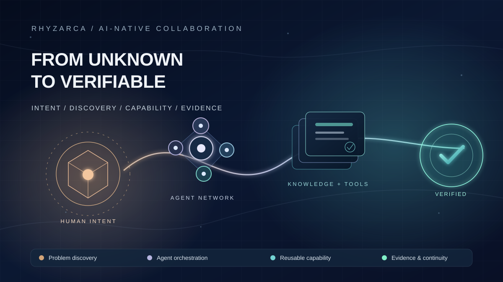
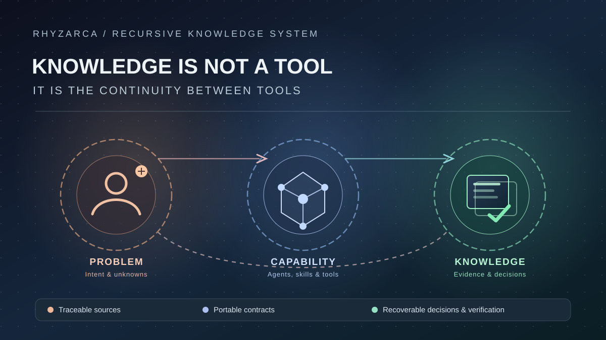

*圖一：從未知走向可驗證成果。人類先提出意圖，AI 自主研究、組織專業與工具，逐步形成成果並留下可追溯的知識。此圖為本文原創概念示意，非任何平台的官方系統架構。*

> **TL;DR**  
> Vibe Coding 的真正困境，常不是人類不會寫提示詞，而是工作分工仍假設：人類必須先理解技術與解法，才能交辦給 AI。本文從一句模糊的採購需求出發，推導「未知驅動的能力累積式協作」：AI 自主研究、使用工具、動態組織同平台與跨平台 Agent，透過原型與提問引導人類選擇，再以骨牌式驗收逐段交付；知識庫、工具庫與認知帳本共同保存來源、決策、錯誤及能力，使下一個模型或工具可以繼續。文中採購案例為合成教學情境；已核對的算術、公開工具能力與尚待驗證的工程閉環嚴格分開。

---

### 一、AI 比學生更懂程式，為什麼學生還得先知道答案？

一名上過 Vibe Coding 課程的學生，已經學會用自然語言要求 AI 建立功能。進行到一半，AI 卻問：「請提供儲存會員資料的程式檔案路徑。」學生不知道檔案在哪裡，工作突然停住。

這個現象值得追問：當 AI 本來就有能力搜尋專案結構、讀取程式碼、辨認資料庫模型時，為什麼最不了解技術的使用者，反而要先提供技術答案？

傳統軟體開發通常是人類專家研究需求、拆解任務、決定路線，再交由團隊執行。許多 Vibe Coding 操作方式仍沿用這個框架：使用者必須知道該問什麼、指定哪個檔案、要求哪種工具，AI 才有辦法繼續。

但現在的 AI 並不是只有模型預先記住的知識。它可以在授權範圍內使用瀏覽器、專案搜尋、GitHub、資料庫查詢、API、MCP、Skills、研究型知識庫，甚至尋求另一個 Agent 的協助。當某個方法失效，還可能研究替代工具，或建立新的工具封裝。

**使用者不知道答案，與解決問題所需的資訊無法取得，是兩件不同的事情。**

如果 AI 有合法讀取專案的入口，就應先探索；沒有入口時，則明確指出缺少何種權限或資料，並完成其他不受阻擋的工作。不能把「要求使用者猜出檔案位置」當作唯一解法，也不能為了自主性繞過權限。

本文想討論的不是更精巧的 Prompt Engineering，而是：**人與 AI 是否可以同時從未知出發，讓工作本身成為取得知識、釐清需求、累積能力的過程？**

#### 協作的第一個改變：把「我不知道」改成一條可以走的路

假設學生真的不知道會員資料放在哪。成熟的人機協作不該只把答案交還給他，而應讓 AI 先說明：「你不用知道程式在哪裡，我們先看目前有哪些入口。你有授權給我讀取專案嗎？若有，我先做唯讀搜尋；若沒有，我可以帶你打開專案資料夾、截取不含敏感資訊的目錄畫面，或產生一段交給有檔案存取能力的 Coding Agent 的指令。」

學生只需完成自己能做的操作，看到 AI 找出的幾個候選模組後，反過來認識系統結構；AI 則透過人類操作取得先前沒有的環境線索。**雙方不是一個出題、一個答題，而是共同搭建通往答案的入口。**

這也替全文建立一個不同於「AI 很強大」的衡量方式：遇到陌生任務時，AI 是否能把自己的能力缺口轉成使用者能完成的下一步；使用者完成下一步後，AI 是否又能將新資訊接回研究與執行，而不是要求人類反覆從頭說明。

---

### 二、趙括與 AI 專業軍隊：改變的是整個能力結構

「紙上談兵」的問題之一，是指揮者、執行者與真實情境之間存在巨大資訊落差。假設前線單位不了解全局，也沒有自主取得資訊的能力，紙上規劃就容易在現場失效。

但如果每個單位都是具備廣泛專業知識、能讀取外部資料、取得工具、向其他專家求助的 AI Agent，指揮者的工作就可能改變。

人類不再需要逐一教導每個 AI 如何執行所有專業細節。人類提供目標、現實背景、時間與成本限制、價值取捨、不可接受的風險；AI 自行尋找方法、組織執行與驗證。

尤其重要的是，執行 Agent 不應只能服從上層規劃。當研究發現更成熟的現成工具，或測試證明某項前提錯誤，它應能回報：「原來的計畫不再是最好的方案。」

這並不代表模型無所不知。模型會犯錯、工具可能失效、不同 Agent 可能互相誤解。然而這些是需要透過證據、測試、授權與回復機制處理的工程問題，不應成為要求非專業使用者事先掌握所有技術的理由。

| 傳統分工 | AI 原生分工 |
| --- | --- |
| 人類先提出完整解法 | 人類可以先提出模糊意圖 |
| 人類研究技術並分配職務 | AI 主動探索知識、動態組織 Agent |
| 已有工具不足就等待專家 | AI 研究、適配或開發新工具 |
| 規格固定後才進入開發 | 研究與原型可能反過來改變規格 |
| 換人或換工具常要重新交接 | 從持久化知識、任務與能力狀態接續 |
| 產品完成後專案結案 | 單次產品可結案，知識與能力仍可累積 |

OpenAI 在 [Harness Engineering](https://openai.com/index/harness-engineering/) 討論了「人類掌握方向、Agent 負責執行」及工程知識如何留在 Repository。本文想追問更前面的一步：**如果連人類要的是什麼，都尚未完全確定呢？**

#### 人類並非旁觀者：兩個方向、兩種不同的成長

在本文的分工裡，「AI 主導技術研究」並不等於「人類只負責按同意」。有時人知道自己為什麼痛苦，卻無法說出技術名詞；AI 知道可以用哪些工具，卻看不到當事人眼前的介面、沒有某項資料授權，也不能替他選擇願意承擔的代價。

因此，一次協作至少要有**雙向回合**：AI 主動提出能執行的探索方式與可理解的選項；人類操作可用的介面、提供安全的情境線索、指出結果與真實工作的落差；AI 更新任務與知識，使用者也從結果學會辨識問題與選擇。下一輪，兩者都不應回到最初的認知起點。

| 當下發現 | AI 應主動提供 | 人類實際參與 | 雙方新增的能力 |
| --- | --- | --- | --- |
| 不知道資料位置 | 搜尋方案、工具連線與截圖引導 | 授權、操作或提供去識別化畫面 | 人理解資料入口；AI 取得環境結構 |
| 不知道技術怎麼選 | 比較成熟方案與原型 | 依目的、成本與使用習慣選擇 | 人理解取捨；AI 更新需求 |
| AI 缺少某項能力 | 研究 MCP／API／其他 Agent | 核准安裝與分享必要測試結果 | 人學會使用工具；AI 累積可驗證技能 |
| 系統結果不正確 | 解釋來源與差異，提出修復路徑 | 指出現實違和之處並驗收 | 人理解判斷依據；AI 留下失敗經驗 |

---

### 三、第一張骨牌：從一句模糊的採購需求開始

以下是一個**合成教學案例**。角色對話、工具選用及任務進展是用來說明方法的情境推演，不是已完成的跨平台產品實測。後面使用的價格與數量資料則可單獨驗算，兩者不可混為一談。

使用者說：

> 「每次主管問我到底該跟哪家廠商買東西，我都要花很久找資料、核對報價。我也不知道怎麼改善，你能幫我解決嗎？」

他沒有要求網站、APP、資料庫或 AI 模型，甚至不知道是否應該自行開發工具。

傳統開發容易立即問他需要哪些欄位、要用什麼資料庫、畫面怎麼設計。AI 原生協作則應先研究問題與市場解法，提供幾個具體選項：

| 選項 | AI 提議的成果 | 重要取捨 |
| --- | --- | --- |
| A：自動整理資料 | 集中 Excel、PDF 與附件 | 省輸入時間，仍需自行比較 |
| B：報價比較 | 統一規格、單位、成本與交期 | 需要確認比較規則 |
| C：採購決策輔助 | 加入更多條件及可追溯理由 | 需求與驗證成本較高 |

使用者在看過示意之後說：「先做 B，但我想知道 AI 為何推薦某家廠商。自動下單不用。」

這時需求才第一次變得清楚：**建立一套可追溯比較依據的報價工具，不進行付款與下單。**

這裡的關鍵不是 AI 幫使用者寫出一份規格書，而是 AI 透過研究、選項與示意，讓原本沒有足夠專業知識的人，逐步知道自己真正想要什麼。

> **在傳統開發中，需求是工作的起點；在 AI 原生協作中，需求也可以是探索的成果。**

初次選擇應立即留下紀錄：原始意圖、候選方案、選擇理由、暫定範圍、未解問題。下一個 AI 需要知道的不只是「最後選了 B」，還要知道「為什麼沒有選 A、為什麼暫緩 C」。

#### 人機協作現場：讓使用者先「看懂可選擇的結果」

這時 AI 不只是列出 A、B、C，還應幫一位不懂程式的採購人員**親眼看見三個方案的差異**。它可以產生簡化的比較畫面，或者先用一張不涉及真實廠商的範例表：A 幫你整理文件、B 替你比較數字、C 再解釋推薦理由。使用者不必學會前端框架，便可以回答「這個畫面有幫到我」或「我真正想省的是主管追問時查證價格的時間」。

假設使用者說：「我平常都在手機上回覆主管，而且最後一定要能找到原始報價。」AI 就應反過來修正先前可能偏向桌面操作的設計，並把「手機可讀」與「追溯原始文件」加入暫定驗收。**人的真實使用經驗，可以推翻 AI 研究出來的平均最佳解。**

這一輪的協作不要求人類懂技術，而是要求 AI 把技術取捨翻譯成可觀看、可試用、可拒絕的結果。人類從模糊抱怨成長為能辨認需求差異的決策者；AI 從抽象需求成長為掌握真實情境的執行者。

---

### 四、第二張骨牌：資料不知道在哪裡，應先讓 AI 找

使用者進一步說：「報價可能在 Google Drive，也有郵件附件、PDF 和同事傳的試算表。我根本不知道放在哪。」

這不應自動把開發推回使用者。

Coordinator 可以建立一個未知事項 U-001，描述需要找的是哪些資料、目前有哪些可用工具、已取得什麼權限、什麼工作會受到影響。然後讓資料探索 Agent 在已授權範圍內使用 Drive 搜尋、郵件查詢、專案檔案搜尋、瀏覽器或 API，辨認可能的來源。

若缺少權限，AI 應明確告訴使用者：「目前能搜尋 Drive，但不能讀取公司郵件。你可以授權郵件唯讀查詢，或先上傳幾份去識別化範例。」而不是要求他提供自己也不知道的完整檔案路徑。

| U-001 欄位 | 工作內容 |
| --- | --- |
| 已知 | 使用者需要比較供應商報價 |
| 未知 | 文件分散位置、格式、版本及可用權限 |
| 可用探索 | 雲端搜尋、郵件查詢、MCP／API、檔案索引 |
| 可先行工作 | 合成資料原型、資料欄位設計、畫面草圖 |
| 受阻工作 | 正式匯入與真實來源準確性驗證 |
| 結案證據 | 原件識別、來源、授權、讀取結果與版本 |

**未知是一個具名、可探索、可分派、可結算的任務，不是聊天中無法繼續的問號。**

而且，一項未知只阻擋依賴它的工作。沒有真實報價檔案，仍然可以先建立比較原型；但不能把合成測試當成真實資料匯入已成功。

#### 人機協作現場：找不到資料時，AI 應提供四條可以立即行動的路

當使用者說「我不知道檔案在哪」，AI 不應只給一個空泛建議。它應先報告自己**實際可使用的工具**，再依當前平台能力提供分支，讓使用者從最省力的一條開始。

**路徑 A：已連接 MCP／雲端服務。** AI 可以先說：「如果你已連線 Google Drive 或郵件，我先在獲授權的資料中搜尋報價、供應商名稱、PDF 與表格欄位；你只需要確認哪個搜尋結果是你平常使用的版本。」如果尚未連線，它應提供該平台的官方連接入口與畫面引導，說明需要哪些權限，**由使用者自行完成登入和授權**，再重新測試可讀取範圍；不能假裝 MCP 一連上就具備所有服務權限。

**路徑 B：資料只存在已登入的網站或公司入口。** 如果目前 AI 客戶端支援受信任的 Chrome 瀏覽器擴充功能或瀏覽器操作工具，AI 可以引導使用者打開報價列表頁、確認可操作的分頁，再依授權進行導覽或讀取畫面。以 [Claude Code 搭配 Chrome 的官方說明](https://code.claude.com/docs/en/chrome) 為例，支援的環境可透過瀏覽器擴充功能協助測試與互動，但登入或驗證畫面仍可能需要由人處理。**這是依平台、版本與權限而異的能力，不代表任何聊天視窗都能自動看見使用者的 Chrome。**

**路徑 C：沒有可用連線工具。** AI 應直接教人：「請先到你平常查看供應商報價的頁面，截取左側導覽及檔名列表即可；先遮住姓名、信箱、報價金額及任何不必提供的資訊。若截圖不足，我會只問下一張需要看到的畫面。」使用者貼回經過遮蔽的截圖，AI 協助辨認所在模組、下一個可按的按鈕與可能的資料來源；必要時也能讓使用者上傳一份經授權的去識別化範例。**截圖是使用者主動提供的線索，不代表 AI 已獲得後續操作權。**

**路徑 D：另一個 AI 才有合適的工具。** 如果目前對話沒有存取本機檔案或 Chrome 的能力，AI 不應叫使用者自己研究如何換工具，而要生成**可直接交給另一個有能力的 AI 執行的完整交接指令**，例如：

> 你現在負責「報價來源唯讀盤點」。使用者不知道檔案路徑，請在本次已授權的專案／雲端來源中，搜尋報價 PDF、試算表及資料匯入設定。不要修改、上傳或刪除原件，也不要要求使用者貼憑證。請回報候選路徑或資源識別、來源依據、你真正成功讀取的範圍、尚缺的權限，以及下一步建議；若無存取能力，請提供最小的使用者操作指引，不要猜測結果。

AI 應告訴使用者：「把這段交給具備對應工具的 Claude／Codex／其他 Agent，等它完成後把結果貼回來，我會依回執繼續。」對不具備自動跨平台傳輸的情境，人類扮演的是**有意識的交接橋樑**，不是要學會自己處理技術細節。

這四條路可能因環境而有所替換。**真正的原則是先利用現有能力，再以最少的人類操作補足合法入口，最後把取得的結果接回同一個未知項目 U-001。** 人類學會一種取得資料的方式；AI 獲得對原本封閉環境的新認知。

---

### 五、第三張骨牌：AI 缺少的可能不是答案，而是工具

資料探索 Agent 找到了文件，卻發現有些 PDF 是掃描圖，文字解析不完整。另一份文件還混用了「每盒」、「每件」、「每批」等單位。

此時可以有兩種反應。

舊模式是把困難交回使用者：「請安裝 OCR，轉成 Excel 再提供給我。」

新的模式是把工具缺口當成 AI 自己的研究任務：盤點現有 PDF 解析函式庫、OCR 服務、Google Document AI、文件理解模型、GitHub 開源專案、可重用 Skills 及 MCP 工具。接著比較其輸入限制、資料安全條件、價格、正確率與維護成本。

如果找到成熟工具，就試用並驗證；若不適合，則封裝、整合或開發缺少的部分，再以固定資料測試。沒有通過測試的工具只可列為候選，不能宣稱成為已驗證能力。

~~~text
需要處理掃描報價
        ↓
查詢既有能力與工具庫
        ↓
研究外部工具、官方 API、開源方案
        ↓
用清晰／模糊／不同排版的文件驗證
        ├── 可用 → 保存版本、限制、測試與介面
        └── 不足 → 修改、建立適配器或改用新工具
                        ↓
                    再次驗證
~~~

這正是 **AI 工具驅動的能力增長**。這裡的「成長」不代表模型權重在對話後自動改變，而是 Agent 系統能調用的知識、工具、測試方法與協作能力增加了。

下次遇到其他公司報價，或另一個領域的文件，AI 不必再從零研究所有 PDF 工具；它可以先讀取先前已驗證的工具及失敗案例，判斷新情境是否適用。若不適用，則啟動新的研究分支。

Anthropic 在 [Writing Effective Tools for Agents](https://www.anthropic.com/research/writing-tools-for-agents) 討論工具設計、原型與 Agent 評估。本文的進一步主張是：**工具的實測結果與操作經驗，應與領域知識一起成為下一次任務的可重用資產。**

#### 人機協作現場：工具由 AI 研究，連線與信任由人共同建立

假設 AI 研究後建議使用文件 OCR 服務，但使用者不知道「MCP Server」、「API Key」或「環境變數」是什麼。好的引導應該先說明目的：「這項工具是為了讀取掃描 PDF，我們先用一份去識別化測試檔確認它是否真的能讀對數量和價格。」接著提供可理解的差異，例如雲端服務與本機解析各自的成本、資料傳輸位置與適用情境。

若工具需要登入或權限設定，AI 應把工作拆成清楚的合作步驟：先提供可信的官方文件與預計使用的權限；使用者自行登入、核准或拒絕；AI 再引導確認工具清單是否出現所需能力，並測試一份非敏感資料。當使用者遇到不認識的介面時，可以傳回**經遮蔽的錯誤訊息或截圖**，由 AI 解釋下一步。不要要求把密碼、Token 或金鑰直接貼到聊天。

如果某個平台不適合進行工具設定，AI 還可以產生給具有 CLI／IDE 能力的另一位 Agent 的執行說明，要求它先核對作業環境、列出會修改的設定與權限，再由使用者批准需要的變更。跨平台執行者必須回報實際執行結果，不能只說「應該已經安裝好」。

完成後，AI 除了保存工具版本與測試結果，還應保存一份人類看得懂的**操作卡片**：「這個工具解決什麼、下次在哪裡啟用、看到哪種錯誤該停下來。」使用者學會管理一項新能力，AI 系統也得到可在未來任務中重複使用的工具與經驗。

---

### 六、第四張骨牌：誰來拆解 Agent？為什麼一定要人先指定角色？

資料、解析、比較規則、介面與測試開始形成多種專業工作。這不代表使用者必須事先建立一份固定的 Researcher、Developer、Reviewer 名單。

Coordinator 應按任務性質判斷哪些工作能由現有工具直接完成、哪些需要不同 Agent 並行、哪些適合獨立審查，以及何時值得跨平台協作。

**同平台協作**可以運用原生子 Agent 分工研究、設計、實作與測試。每個子 Agent 也能在授權與編排條件允許下進一步拆解自己的未知，或呼叫工具。這是一種遞迴的問題解決過程，不是無限制地產生 Agent。

**跨平台協作**則允許不同平台提供互補能力。例如一方擅長研究並整理文件，另一方負責程式實作，第三方對計算公式或測試資料提供獨立覆核。交換的不是籠統的「幫忙看一下」，而是帶有目標、輸入、產物、執行身分及驗收條件的明確工作契約。

**向上修正**更重要。假設文件研究 Agent 發現已有成熟服務能處理大部分欄位，它應提出修訂建議，讓 Coordinator 取消重複開發；Tester 發現比較規則錯誤，也應回報影響上層需求的證據。

~~~text
人類意圖、限制、授權
          ↓
Coordinator：建立任務圖、選擇能力、定義驗收
          ├── 同平台 Agent：研究／規劃／開發／測試
          │       └── 自行研究工具與遞迴子任務
          ├── 跨平台 Agent：模型專長與獨立覆核
          │       └── 透過合法入口與共享契約交換結果
          └── 知識庫／工具庫／MCP／API
                       ↑
      新發現與失敗 ───┘  回報上層、重排任務
~~~

不是 Agent 越多，結果就越好。Google Research 在 2026 年研究了 180 種配置，指出多 Agent 對可平行化任務較可能有幫助，對序列依賴性高的任務則可能增加協調成本與錯誤傳遞，見 [Towards a Science of Scaling Agent Systems](https://research.google/blog/towards-a-science-of-scaling-agent-systems-when-and-why-agent-systems-work/)。

Rhyzarca 在先前的 [Claude Code × OpenAI Codex Harness Engineering 文章](https://github.com/JerryChien1031/rhyzarca-blog/blob/main/_posts/2026-10-22-claude-codex-harness-engineering-auto-workflow.md) 記錄過限定的 Codex 單平台 Goal-Only 驗收，以及 Codex PRIMARY → Claude 原生 Worker 的指定互斥交接。這些歷史證據支持部分協作元件可行，**不代表 Claude 反向主控、任意跨平台協作或本文採購案例已完成端到端驗證**。這條證據邊界不能省略。

#### 人機協作現場：跨平台不是把兩段聊天同時丟出去

在實際使用中，跨平台最常見的模式未必是自動執行，而是由一個 AI 幫使用者準備給另一個 AI 的任務指令。這時使用者不應被迫自己重述整個專案，也不必懂得如何建立子 Agent 設定檔。

例如 Coordinator 判斷：目前的 AI 擅長研究需求，但另一個具備本機程式存取能力的 Agent 更適合盤點匯入模組。它可以主動產生一份**交接包**：任務目的、當前已知事實、可使用的工具和權限、禁止事項、預期輸出、驗收條件、版本與回報格式。使用者只需在對應平台貼上這份指令，並在需要時同意合法的工具操作。

> 給另一位 AI 的交接目的不是「幫我做個報價系統」，而是「請在指定唯讀範圍找出目前的報價匯入入口，附上路徑與依據；不能確認就標記 UNKNOWN，不修改任何檔案；最後提供可回傳給 Coordinator 的結構化回執」。

另一位 AI 回報後，使用者把**實際回覆**帶回 Coordinator，Coordinator 先核對證據，再更新工作圖與知識庫。這裡有一個容易忽略的時間順序：**先派工，再收件，再根據收件結果給出下一步**。如果同時給兩邊一份尚未包含對方回覆的指令，任何一方都可能在過期情境上繼續工作。只有在共同工作圖、版本、回執與相依契約已經能可靠同步時，才適合自動平行派工。

使用者在這個過程中學到的，不是如何替 AI 編寫每個技術步驟，而是如何辨識「正在請求什麼能力、誰有權做、哪個回覆可相信」。AI 系統則學會記錄不同平台的能力邊界、交接成敗與可重用協作方式。這正是**人類協調能力與 AI 系統協作能力的雙向成長**。

---

### 七、第五張骨牌：研究之後，才發現「最便宜」不是同一件事

AI 取得報價後發現，某些供應商報「每件」，另一些報「每盒十入」；有些單價低，卻需要較高運費。

這時真正應該做的不是立即排序，而是先讓使用者理解不同計算方式如何改變答案。

以下使用三筆**合成資料**。三家公司均提供同規格的 100 件商品，幣別一致；價格採相同稅務口徑，運費固定另加，沒有折扣或特殊採購條件。這只是教學用的簡化前提，不能直接代替真實採購計算。

| 廠商 | 報價方式 | 商品小計 | 運費 | 100 件總成本 | 每件均攤成本 | 交期 |
| --- | --- | ---: | ---: | ---: | ---: | ---: |
| A | 10 盒，每盒 10 入、每盒 980 元 | 9,800 | 300 | 10,100 | 101 | 5 天 |
| B | 100 件，每件 97 元 | 9,700 | 600 | 10,300 | 103 | 2 天 |
| C | 100 件，每件 93 元 | 9,300 | 1,200 | 10,500 | 105 | 9 天 |

直接看商品單價，C 的每件 93 元最低；但比較含運總成本，A 反而最低。如果要求兩天到貨，就只能選 B；如果容許五天交期，並在符合交期的選項裡選最低總成本，就是 A。

上述商品數量、總成本與均攤成本已以固定合成輸入獨立核對。**這只能證明本表在指定前提下的計算相互一致，不能證明 OCR、整套程式或 Agent 協作已經成功。**

AI 可以將結果、來源與公式展示給使用者，再問：「你真正要的是表面單價最低、總成本最低，還是符合交期限制下的總成本最低？」

使用者這時可能第一次發現自己真正要的是：

> 「每份報價先統一單位，考慮運費與交期；在期限內選總成本最低的方案，而且讓我看得到每個數字來自哪裡。」

需求不是由使用者預先精確描述，而是透過 AI 的比較與反例被重新發現。原型不只是提前展示成果，更是在**擴大使用者理解範圍**，讓新的選擇成為可能。

#### 人機協作現場：由 AI 教人看懂公式，而不是要求人先懂公式

當 AI 顯示 A、B、C 的比較時，不應只問「你要哪一個？」它還可以提供可操作的假設比較：把交期上限改為兩天、五天、十天，或讓人選「先保證交期」與「先壓低成本」，即時展示結果如何改變。若當前工具沒有互動介面，AI 也可以先產生三組表格或簡單原型；使用者不用先會寫程式就能提出有意義的修正。

例如使用者看完後說：「主管有時可以等五天，有時明天就要。這應該不是一個固定條件。」AI 就應從單一排序改為**使用者每次可選交期條件**，並展示哪些候選因條件而被排除。這個新需求不是 AI 憑空推導出來，也不是人類一開始就知道如何描述，而是兩者在試算與回饋中共同發現。

人類這一輪增加了理解採購判斷依據的能力；AI 則取得了原先沒有的場景差異，更新比較規則與驗收測試。當 AI 解釋其判斷，人類也更有能力發現 AI 的盲點。

---

### 八、第六張骨牌：沒有公開的產業規則，如何在未知中繼續？

接著發現某家供應商有非公開折扣，另一家有特殊交貨條件。這些資訊可能不存在於網路或公開工具中。

但缺少少數私有規則，不代表整個系統無法開發。AI 可以先繼續完成已知資料的解析、通用比較邏輯與操作介面，將私有折扣設計為可後續接入的規則模組。

真正影響結果時，才向使用者提問：「目前比較未包含你們公司的私有折扣。你可以提供去識別化規則樣本，或選擇本版先不納入；哪種方式符合這次目的？」

這讓使用者做的是**可理解的價值與範圍決策**，而不是被迫回答未知的技術細節。

我會將未知區分為四種：公開可搜尋、授權後可取得、需要使用者提供特定情境或選擇，以及必須經實驗才能確認。若資訊無法合法取得、無法驗證或涉及非法交易，AI 應記錄限制，不能編造來源或尋找繞過權限的路徑。

**AI 應優先自行處理能研究的未知；只在必要的資訊、授權與價值選擇上，引導人類參與。**

#### 人機協作現場：AI 必須教人安全地提供「只有他知道的那一小部分」

若公司確實有未公開的折扣或採購規則，AI 應先界定缺少的是什麼，再提出**最小資料請求**，而非要求整份採購合約或公司資料庫。它可以給使用者一個不含真實商業機密的範例格式：「滿一百件打九五折」、「交期不能超過五天」等，請他檢查這是否對應實際工作；需要真實資料才能驗證時，再依公司制度選擇安全的上傳或受控連線方式。

假如使用者不知道能否分享文件，AI 應先指引他確認資料敏感性與授權，提供「先用假資料完成模組」、「由公司核准的環境處理」、「僅輸入經去識別化的條件」等替代途徑。若這項未知只影響某一分支，其他已可安全研究的部分仍可繼續。

重點不只是讓 AI 得到缺少的規則，而是讓人學會**如何把模糊的隱性經驗轉成可檢查的條件**。下一次遇到相同問題，他更容易提供適當情境；AI 則可將經確認的規則連同來源、適用範圍與版本保存，而不是把一次口頭判斷默默當成通用事實。

---

### 九、第七張骨牌：NotebookLM、Notion 與 MCP，如何讓知識跨平台繼承？

假設研究 Agent 在 Google 的研究筆記工具中整理供應商資料，需求與決策保存在 Notion，程式和測試留在 GitHub。接著原本使用的模型換了，新的 Agent 是否必須再研究一次？

這是整篇文章的另一個核心：**AI 不該被單一模型綁定，知識也不該被單一工具綁定。**

Google 已在 **2026 年 7 月 16 日將 NotebookLM 更名為 Gemini Notebook**。它仍是來源導向的研究工具；Google 也推出 Gemini Notebook API 與 MCP Public Preview，讓相容 Agent 管理筆記本和匯入來源。不過，截至本文撰稿時，官方 MCP 工具主要提供建立、取得、列出或更新筆記本，以及新增與列出來源等能力。**這不等於研究問答、所有產物和歷史對話都可以透過 MCP 完整同步**。其 API 預覽目前也有個人 Google 帳號等限制。[更名公告](https://blog.google/innovation-and-ai/products/gemini-notebook/notebooklm-gemini-notebook/)／[API 概覽](https://developers.google.com/notebook/docs)／[MCP 工具清單](https://developers.google.com/notebook/docs/mcp)。

Notion 則可以作為人與 Agent 協作的需求、任務、研究結論及決策工作空間。[Notion MCP 官方說明](https://www.notion.com/help/notion-mcp) 表示相容 AI 工具能在其權限範圍內讀寫工作空間。[Notion 3.8](https://www.notion.com/releases/2026-10-13) 也將跨 Agent 共享情境與 Skills 作為重要方向。但 Notion 仍是其中一種可替換的服務，而不是認知主權本身。

MCP（Model Context Protocol）的功能，是讓 Agent 透過共同協定發現與使用工具。它**不會自動證明資料正確、解決多 Agent 寫入衝突，也不保證任何模型都能完全重建先前的理解**。在 [MCP 2026-07-28 規格](https://blog.modelcontextprotocol.io/posts/2026-07-28/) 中，工具發現、授權和協定生命週期持續演進；應依當時工具實際開放的功能來設計。

因此，我建議把工具角色分清楚：

| 工具或元件 | 可以承擔的工作 | 必須另外保存的資產 |
| --- | --- | --- |
| Gemini Notebook（原 NotebookLM） | 來源研究、文件整理與分析 | 原始來源、研究依據、版本與未驗證假設 |
| Notion | 需求、方案比較、任務、決策與人類審閱 | 決策理由、需求演化、工作狀態 |
| GitHub | 程式碼、Skills、工具適配器、測試與版本 | 產物版本、測試證據、變更歷史 |
| MCP、API、瀏覽器及其他工具 | 跨服務取得資訊、操作工具 | 授權、工具契約、執行結果與限制 |
| Rhyzarca 認知與能力狀態層（設計方向） | 關聯來源、決策、任務、工具及證據 | 可移轉且可重新建構的權威狀態 |

理想架構不是把所有資料硬塞進某個 Notion Database，也不是讓 Gemini Notebook 成為唯一的研究入口，而是建立可移轉的來源索引、開放格式、版本化契約與必要的同步適配器。

~~~text
Gemini Notebook ──研究與來源──┐
Notion ──────────需求與決策───┤
GitHub ──────────程式與測試───┤
外部 API／文件 ──資料與工具───┘
                 │
        MCP／API／資料適配器
                 │
        Rhyzarca 認知與能力狀態
      來源／版本／決策／工作圖／驗收
                 │
     依權限提供給不同模型與 Agent
      ChatGPT／Codex、Claude、Gemini…
~~~

**這是目標架構示意，不是已完成所有服務同步的實測結果。** 真正跨工具可攜需要驗證資料匯出、Schema 映射、權限、版本、重建與錯誤恢復。換平台後新的 AI 也不會自動得到舊模型的全部內部認知；合理的承諾是：它能從足夠完整、可驗證的外部狀態，重建工作所需的知識與決策背景。

這才符合「工具可換、模型可換，但先前解決未知所累積的認知程度不應歸零」的理想。

#### 人機協作現場：知識庫連線應是一堂「會操作、能搬家」的共同學習

從一個沒有既有知識庫習慣的使用者出發，AI 不應直接說：「你先建 Notion Database，再把研究放進 Notebook。」它可以先問：「你平常用哪個工具看文件？要讓下一個 AI 也能接著用，你願不願意先保留一份可匯出的來源清單與決策紀錄？」然後提供**最小可行選項**：

**選項 A：已使用 Notion。** AI 引導使用者查看目前 AI 平台是否支援 Notion MCP 或相容的連線方式；由使用者檢視授權畫面並完成連線。成功後，AI 先做最小唯讀測試，確認能讀到指定頁面，再建議將最新需求、被排除方案與待決問題寫入適當的工作空間。Notion 官方 [MCP 說明](https://www.notion.com/help/notion-mcp) 提供連線途徑，但各客戶端的操作入口不同，不能假設所有帳號都有同樣的按鈕。

**選項 B：偏好 NotebookLM／Gemini Notebook。** AI 先協助使用者將官方文件、測試依據與研究問題分類，必要時教他匯入來源；若目前客戶端支援 Gemini Notebook 預覽 API／MCP，可以依官方能力進行筆記本與來源操作。**若介面沒有提供研究問答匯出或相應 MCP 工具，就不要假裝能完整同步**；可改以經核對的 Markdown 來源索引、決策摘要與原始文件清單作為可轉移資料。

**選項 C：目前不想連任何服務。** AI 直接產生一份人類看得懂、其他模型也能讀的 Markdown 交接包，包含需求版本、來源連結、已確認／未確認事項、工具能力與待辦；使用者可以保存到自己控制的檔案或 Git Repository，以後再遷移到 Notion、Rhyzarca 或其他資料庫。

真正完成連線之後，AI 應教使用者做一次**交接演練**：在另一個 AI 或新視窗中，只提供可授權取得的外部資料，看它能否說出最新需求及已排除方案。若兩邊理解不同，便檢查是哪份摘要遺失、哪個來源未授權，並讓人類指出哪一版才符合自己的選擇。

如此一來，人類得到的是跨工具管理知識的能力，AI 系統得到的是經驗證的資料路徑與連接契約。**連上 MCP 是取得入口；成功交接才是認知連續性開始被驗證。**

---

### 十、知識庫如何讓 AI 真的成長，而不只是儲存更多文件？

如果 AI 每次解決問題後，只把摘要複製到 Notion，沒有來源、驗證狀態與工具版本，那麼知識庫可能越大，錯誤卻也越多。

我認為至少應保存四種不同的資產。

**一、事實與研究（Evidence）**：原始文件、來源位置、取得時間、適用條件，以及哪些仍只是假設。

**二、決策與認知歷史（Decision）**：使用者選擇什麼、放棄什麼、當時的理由，以及哪些新證據讓原決策改變。保留被推翻的舊看法，是為了防止下一個 Agent 重踩相同問題，不是讓舊答案永遠有效。

**三、工具與技能（Capability）**：已驗證的 MCP 工具、API、Skills、解析模組，及其版本、權限、測試資料與已知失敗模式。新任務要先檢查適用性，再復用。

**四、執行狀態（Execution）**：工作圖、Agent 身分、真實工具回執、依賴、產物版本、驗收與恢復入口。聊天中的「準備執行」不能冒充實際工具受理。

這些資訊互相連接，卻不能混成一份摘要。研究結論不是操作成功；某次測試 PASS，也不代表其他版本或部署環境自動通過。

例如下一次要處理物流單據，Coordinator 應先從能力登錄找到已驗證的文件解析工具，核對新文件格式是否落在其適用範圍內。若適用，直接復用；若不適用，建立新的研究項目。成功與失敗都能回饋系統。

我把這種現象稱為**能力累積（Capability Compounding）**：不是模型權重在對話中神奇地改變，而是系統每次工作後，真正能夠重用的知識、工具與經驗增加了。

Anthropic 的 [Effective Context Engineering](https://www.anthropic.com/research/effective-context-engineering-for-ai-agents) 說明了如何管理工具、資料和歷史上下文；[Effective Harnesses for Long-Running Agents](https://www.anthropic.com/engineering/effective-harnesses-for-long-running-agents) 則討論如何跨上下文窗口留存工作進度。本文將這些工程方向延伸為更長期的跨模型、跨工具、跨任務能力管理。

#### 人機協作現場：知識庫也需要人類教 AI 什麼值得留下

AI 每次完成任務，應把「可確認的事實」、「尚需測試的假設」、「工具使用經驗」整理成候選知識，讓使用者以能理解的方式檢視。例如 AI 想記錄「供應商比較以最低含運成本優先」，使用者可以指出：「這只適用於交期允許時，不是我永遠的偏好。」

如果沒有這個回合，知識庫可能把一次性決策固化成長期規則，反而傷害下一次工作。使用者學會區分**個人偏好、當次條件與通用知識**；AI 也學會在保存資料時明確標記適用場景、信念程度、確認者與重新驗證條件。

| 本輪留給人類的成長 | 本輪留給 AI 系統的成長 |
| --- | --- |
| 知道文件如何取得、哪些欄位值得檢查 | 有經驗證的搜尋入口與文件解析工具 |
| 理解總成本、交期與計算依據的差別 | 有新版比較規則、測試案例與失敗紀錄 |
| 理解 Notion／Notebook 與 MCP 的用途與邊界 | 有跨平台來源索引、授權範圍與交接契約 |
| 能檢查與修正 AI 的建議 | 有明確的人類決策理由及更新後的適用範圍 |

這是兩個方向的能力增加：**人類愈來愈懂如何與專業 AI 工作，AI 系統愈來愈了解如何在適當情境下有效協助這個人**。成長不必相同，卻應能彼此促進。

---

### 十一、第八張骨牌：錯誤發生時，如何不讓整個系統跟著倒塌？

假設 Tester 發現系統將「每盒十入」錯當「每件」，使報價排序錯誤。這時絕不能只因為 Developer 說修好了，就繼續交付。

真正可靠的骨牌模型，不是把大型工作切成一串固定順序，而是把它建立成**可分區、可中斷、可重排的相依圖**。

~~~text
U-001 報價來源 ──────┐
                    ├── D-010 文件解析
U-002 格式研究 ──────┘         │
                              v
U-003 比較條件 ──────> D-020 單位與總成本
                              │
介面原型 ─────────────────> D-030 結果展示
                              │
                              v
                        V-040 獨立驗收
                        /             \
                     通過             失敗
                      │                │
                   分段結算       找到受影響節點
                                       │
                                   修復並重測
~~~

每個區塊都應保留目標、輸入、依賴、產物、版本、驗收條件與證據。如果 D-020 失敗，就重新驗證受其影響的比較結果；已完成、且不相依的資料來源盤點可以保留。若程式已修改，舊版本的 PASS 也不能被直接沿用。

這個機制有四個目的：**定位錯誤、阻止擴散、避免重做、保留恢復路徑**。

同時，修復錯誤也可能產生新能力：例如將「報價單位正規化」做成獨立工具，通過合成與真實資料測試後登錄，未來其他文件分析工作便可能復用。

這裡會再次回到 Harness Engineering：文字提示可以要求 Agent 小心，但不能取代真實的寫入認領、工具回執、版本對帳、獨立驗證與回復。治理應限制的是副作用、責任與證據，而不是把 AI 的研究方式寫死成固定劇本。

#### 人機協作現場：錯誤畫面也可以由人類帶回，讓 AI 形成可重現的修復

真正使用時，使用者可能只會說：「這份報價看起來怪怪的，我也不知道哪裡錯。」AI 可以引導他截取**錯誤排序所在的局部畫面**，遮蔽非必要欄位，再指出畫面上的單位、數量與計算結果。它可以向人確認：「你看到的這個 980 元，是一盒的價格，還是一件的價格？」而不是要求使用者直接定位程式碼 Bug。

如果修復需要另一個平台的工具，AI 產生具備測試資料、預期值、目前結果與修改範圍的執行指令交給 Coding Agent；對方完成後回傳程式版本、測試輸出及仍未修復的部分。Coordinator 再向使用者展示**修復前／修復後**的比較，而不是只回一句「已修好」。

這一輪，人的真實工作直覺提供了新的錯誤線索；AI 把線索轉成可重現測試與工具修正。使用者也從前後對比學會識別下一次的單位錯誤。**人不需要懂如何修 Bug，仍然能在發現、定位、驗收三個環節做出不可替代的貢獻。**

---

### 十二、第九張骨牌：換一個對話、換一個平台，能不能接著做？

假設最初由一個 AI 分析資料，過幾天使用者換成另一個 AI，甚至替換 Notion 或 Notebook 工具。新的 Agent 不應從頭問：「你究竟想開發什麼？」

它應能取得一份可核對的交接狀態：

| 項目 | 接手 Agent 必須能回答 |
| --- | --- |
| 最新需求 | 真正要交付的成果是什麼？哪些選擇經使用者確認？ |
| 研究來源 | 哪些資訊已驗證，哪些只是猜測？ |
| 設計決策 | 為什麼採用目前方案，哪些方案被排除？ |
| 工具能力 | 哪些工具已測試，版本與適用條件是什麼？ |
| 工作圖 | 哪些區塊已結算、失敗、阻擋或狀態不明？ |
| 產物與證據 | 哪份程式及哪組測試支持目前宣稱？ |
| 授權限制 | 能讀什麼、改什麼、何時必須讓人類確認？ |

這裡最容易出現假象：新的 Agent 能複述一段精彩摘要，就被認為「無縫接手」。但真正的接手必須能從狀態與工具中重建因果關係，在不重複有副作用操作的情況下繼續工作。

可以設計一個驗證：不提供舊對話全文，只交付外部知識、任務圖與能力登錄。要求新 Agent 找出最近一次使用者決策、已排除方案、尚未完成的驗收，以及可復用的文件解析工具。再確認它實際讀取的內容、版本與測試輸出是否符合。

如果做不到，就代表我們保存的只是資訊，而不是足以延續工程的認知狀態。

這和 Rhyzarca 先前的 [〈數位巴別塔〉](https://blog.rhyzarca.com/2026/09/agi-rhyzarca_0615099013.html) 是同一條思想脈絡：重要的不只是資料沒有消失，而是能從答案走回證據，從結果回到設計理由，從失敗重新找到可建構的路。

#### 人機協作現場：換平台時，人類不必重新當一次需求分析師

現在試著把對話切斷。使用者打開另一個 AI，對前一次技術討論已經記不清楚。理想的引導不是讓他把幾萬字聊天記錄重新複製，而是由前一個 Coordinator 主動準備**短小但可驗證的交接包**：最新需求、選擇歷史、完成與阻擋的骨牌、外部知識索引、工具版本、授權邊界及下一項可做的工作。

若新 AI 有被授權的 MCP 或 GitHub 存取權，便依交接包自行讀取；若沒有，舊 AI 應生成**一段可貼給新 AI 的啟動指令**，說明要去哪裡取得哪些已存在的資料、如何核對版本，以及缺少權限時應向人類提出哪個最小請求。

> 你將接續「報價比較」而不是重新立案。請先讀取已授權的需求版本、決策紀錄、工具能力清單與驗收摘要；回答目前目標、哪些方案已排除、哪個任務仍被阻擋。未驗證的部分請標記 UNKNOWN。完成狀態對帳前不要重新執行寫入、提交或發布，也不要要求使用者重述整個背景。

使用者把新 AI 的第一次對帳結果帶回，確認它理解的目的是否正確；只有確認後才讓它繼續研究或執行。若沒有自動共享的控制平面，**先收件、再向另一端同步**，避免兩邊根據不同版本同時行動。這個簡短的人類確認回合，反而讓跨平台協作可以兼顧自主性與認知正確性。

---

### 十三、最後一張骨牌：什麼時候停止探索，交付真正的成果？

AI 可以不斷找到新工具，也能無限遞迴拆解。如果每個改善都變成這次必須完成的工作，產品就永遠沒有交付日。

所以應區分**使用者成果條件（User Acceptance Criteria）**與**AI 推導的工程條件（Derived Acceptance Criteria）**。

使用者成果條件來自人機共同形成的需求，例如「比較相同規格與數量的含運成本、保留來源依據、不自動下單」。工程條件則是 AI 為了達成這些要求，推導出的單位換算、異常輸入、文件解析、測試等必要檢查。

Derived AC 可以在證據充分時修訂，但不能偷偷放寬 User AC。產品符合有效驗收條件後，就應結算；新的研究方向則進入知識庫與下一輪工作。

回到合成案例，至少應驗收：

| 項目 | 可檢查的結果 |
| --- | --- |
| 需求對齊 | 使用者確認交期、總成本、來源追溯與本次不下單 |
| 數量正規化 | 10 盒、每盒 10 入被視為 100 件 |
| 合成算術 | A 為 10,100 元；B 為 10,300 元；C 為 10,500 元 |
| 比較條件 | 可切換總成本、交期與條件篩選 |
| 資料追溯 | 結果能定位到來源及計算依據 |
| 未知處理 | 未公開折扣與無法識別欄位不能被任意補值 |
| 中斷恢復 | 能以固定狀態及證據在新 Agent 中接續 |
| 授權邊界 | 不在本次範圍內自動付款、下單或修改正式資料 |

**目前只有表中的合成算術經過獨立核對。** 其他項目是要讓整套理論從思想走向工程的驗收設計，不能在尚未執行時宣稱全部 PASS。

這也使我們能分清兩種進度：單次產品任務有終點；知識與工具能力可以在下一個任務中繼續累積。

#### 人機協作現場：交付前最後一次「你真的想要這個嗎？」

AI 可以提供一個簡短的驗收導覽，而不是把一份技術測試報告交給使用者：先用樣本上傳一份報價，請使用者確認讀出的品項與單位；再切換兩天與五天的交期限制，讓他自己看到結果變化；最後點開推薦理由，對照原始來源。若某一環節與他的實際工作不符，就由 AI 協助新增或修訂相應的驗收條件。

例如使用者確認：「這版已經能省去大部分整理時間，私有折扣先留給下一階段。」AI 就應把這個選擇寫成**當次明確的交付邊界**，列出已完成與尚未完成的功能，並把後續可能增加的能力放進待辦，而不是無限推進自己想到的新功能。

於是，人類學到如何用具體結果驗收專業工作，而不是只憑感覺相信 AI；AI 系統則保留真實的使用者驗收依據，懂得何時收斂、何時把新未知交給下一輪。這才是彼此成長後共同完成的成果。

---

*圖二：問題探索、能力增長與知識累積形成回饋循環。工具和模型可以更換，經驗、決策與可驗證的成果則應持續保留。*

---

### 十四、Rhyzarca 的更大命題：讓需求、工具與知識一起演化

把整個故事串起來，我認為這套協作方式包含三個同時運作的循環。

**問題循環**：人類提出模糊目的；AI 研究、提問並展示原型；使用者逐步理解取捨；需求在每次驗證後重新形成。

**能力循環**：AI 遇到資訊、專業或工具缺口，主動搜尋、評估、使用或建立工具，動態組織同平台與跨平台 Agent；驗證後保留可重用能力。

**知識循環**：研究來源、決策理由、錯誤經驗、工具版本與工作狀態被保存，讓不同 AI、不同平台與不同時間的執行者都能在可信基礎上接續。

三個循環不是固定的先後順序。工具發現可能改變需求，測試可能推翻架構，人類看到原型可能改變偏好，跨平台 Agent 的審查也可能使前一輪工作重新驗證。

這裡真正有別於一般 Vibe Coding 教學的觀點是：

> **AI 不只負責解決人類交付的問題；它還應在解題過程中，與人類共同發現問題、擴充自身可用能力，並讓這些能力在模型與工具更替後仍能被理解、驗證和繼承。**

這不是否認人類的價值。人的價值不是記住多少 API 名稱或資料庫欄位，而是在探索的每個階段提出目的、理解選項、做出取捨、確認結果，必要時推翻 AI 的建議。

真正的 AI 原生開發，不是讓每個人都成為軟體工程師，而是讓不熟悉專業方法的人，也能開始組織一場可靠的專業問題解決過程。

**未知不再必然是工作的終點；每次被解決、被驗證、被保存的未知，都可以成為下一次探索的起點。**

#### 從「人給 AI 指令」走向「AI 引導人、人回饋 AI」

回看每張骨牌，真正支撐系統前進的並非任何一方事先知道所有答案，而是一連串交替的能力交換：AI 幫人理解有哪些工具、如何連接、怎麼取得安全的環境線索；人以授權、截圖、操作回執、情境判斷和驗收結果，幫 AI 跨越單憑模型知識無法穿過的現實邊界。

AI 研究、產生下一個可執行步驟；人類實際體驗並選擇；AI 取得新的證據，更新工具與知識庫；人類再從更清楚的結果做出下一個選擇。**人類增長的是理解、操作、選擇與驗收能力；AI Agent 系統增長的是可用知識、工具、情境和協作經驗。**

這樣一來，面對未知不只是有 AI 來解答，也不只是使用者學會新的提示詞，而是**雙方都能在一次次可驗證的人機協作中，變得更有能力解決下一個未知問題**。

---

### 🔗 認知脈絡與延伸閱讀

**外部研究與官方資料**

- [OpenAI — Harness Engineering](https://openai.com/index/harness-engineering/)：Agent-first 工程環境、Repository 知識與回饋。
- [Anthropic — Building Effective Agents](https://www.anthropic.com/research/building-effective-agents)：可組合 Agent、協調者與工作者模式。
- [Anthropic — Effective Context Engineering](https://www.anthropic.com/research/effective-context-engineering-for-ai-agents)：上下文、工具與外部資料。
- [Anthropic — Effective Harnesses for Long-Running Agents](https://www.anthropic.com/engineering/effective-harnesses-for-long-running-agents)：跨上下文窗口交接與持續工作。
- [Anthropic — Writing Effective Tools for Agents](https://www.anthropic.com/research/writing-tools-for-agents)：工具原型、測試與改善。
- [Google Research — Scaling Agent Systems](https://research.google/blog/towards-a-science-of-scaling-agent-systems-when-and-why-agent-systems-work/)：多 Agent 配置的效益與代價。
- [Google — NotebookLM is now Gemini Notebook](https://blog.google/innovation-and-ai/products/gemini-notebook/notebooklm-gemini-notebook/)：2026 年產品更名。
- [Google — Gemini Notebook API／MCP](https://developers.google.com/notebook/docs/mcp)：預覽期介面與工具範圍。
- [Notion — Notion MCP](https://www.notion.com/help/notion-mcp)：外部 Agent 讀寫工作空間及權限。
- [Notion — 3.8 Context for Your Agents](https://www.notion.com/releases/2026-10-13)：跨 Agent 情境與 Skills。
- [MCP — 2026-07-28 Specification](https://blog.modelcontextprotocol.io/posts/2026-07-28/)：協定、授權與擴充。

**Rhyzarca 既有脈絡**

- [〈聰明 vs. 見識〉（GitHub 原始文章）](https://github.com/JerryChien1031/rhyzarca-blog/blob/main/_posts/2026-08-18-intelligence-vs-insight-gemini-notebook-changes-perception.md)：推論能力與知識庫的差異。
- [〈數位巴別塔〉](https://blog.rhyzarca.com/2026/09/agi-rhyzarca_0615099013.html)：保留證據、理由與人類返回理解的能力。
- [〈Claude Code × OpenAI Codex Harness Engineering〉（GitHub 原始文章）](https://github.com/JerryChien1031/rhyzarca-blog/blob/main/_posts/2026-10-22-claude-codex-harness-engineering-auto-workflow.md)：限定實測、跨平台工作狀態與驗收。

---

### 🏛️ Epistemic Ledger Entry: #0010（候選分錄）

- **Timestamp:** 2026-11-06T08:50:00+08:00
- **Claim:** 人類可以從模糊且不完整的需求出發，讓具備自主研究、工具取得與驗證、同平台及跨平台協作、遞迴分工、骨牌式驗收，以及持久化知識與能力狀態的 AI Agent 系統，逐步使需求清晰化並完成產品交付；每次解決未知，都可能同時提升後續工作的可重用能力。
- **Epistemic State:** Tentative Architecture Hypothesis；部分基礎組件有公開工程資料及 Rhyzarca 限定實測，完整閉環仍待驗證。
- **Evidence Scope:** 採購案例的敘事與對話為合成示範；表格的數量與金額經獨立核對。未執行採購原型端到端測試、Gemini Notebook／Notion 實際跨平台遷移或任意多模型自主閉環。Rhyzarca 既有跨平台實驗只適用原文界定的主控方向與受測範圍。
- **Dependencies:** 來源可用性與適當授權；任務與工具契約；可靠執行回執；可追溯知識、決策與版本；適當的獨立驗證、風險控制及停止條件。
- **Falsifier／Revision Trigger:** 若新 Agent 無法從外部狀態正確恢復工作、工具無法跨任務可靠復用、Agent 協調成本高於實際效益，或知識庫中的未驗證資訊持續污染決策，則應修訂本文的適用範圍與架構假設。
- **Next Question:** 如何用可重現的端到端實驗，證明 AI 系統真的累積了能力，而不是只累積更多文件？

#### 協作命題增補：人機雙向成長（2026-11-06）

- **Supplemental Claim:** 本文的未知驅動式開發，不應被理解成 AI 單向取代人類專業工作。完整循環必須包含 AI 將工具與方案轉成使用者能操作、能選擇、能驗收的下一步，以及使用者將實際畫面、授權、情境回饋與判斷反向提供給 AI；雙方在不同方向持續增加能力。
- **Illustrative Mechanisms:** 具權限的 MCP／API 檢索、支援平台的 Chrome 瀏覽器操作、經遮蔽的截圖引導、跨平台任務指令與回執交接、Notion／Gemini Notebook 的來源管理，以及 Rhyzarca 的決策與能力登錄。以上為本文新增的教學情境，不是宣稱本篇已實測所有工具鏈。
- **Validation Needed:** 以非專業使用者參與的實際任務比較兩種流程：一組只接收 Agent 提問，另一組由 AI 主動提供工具引導與跨平台交接。觀察需求對齊、完成率、人類操作負擔、任務恢復、能力復用和雙方對錯誤的識別能力，並保存每個關鍵交接的實際工具回執與使用者確認紀錄。