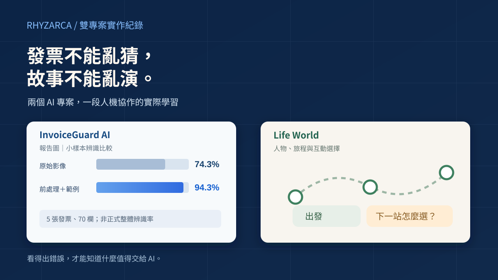
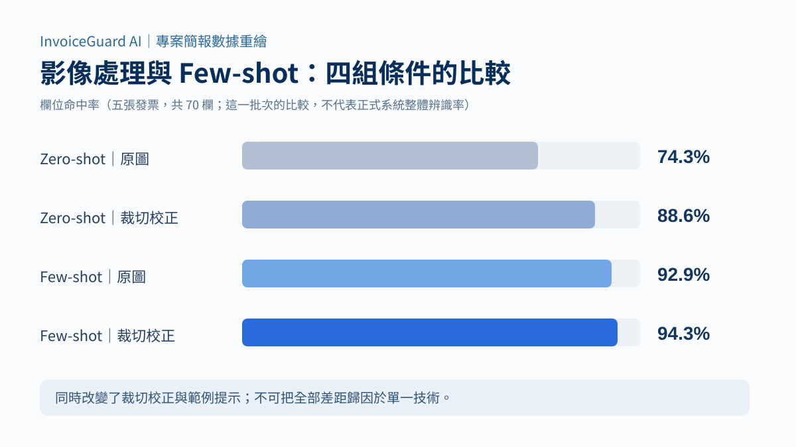
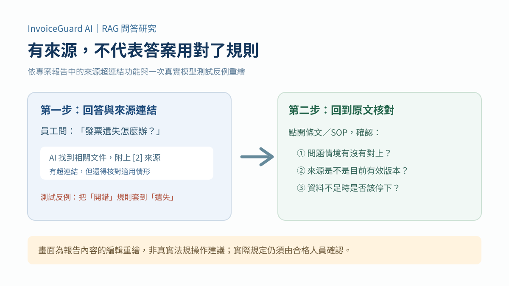
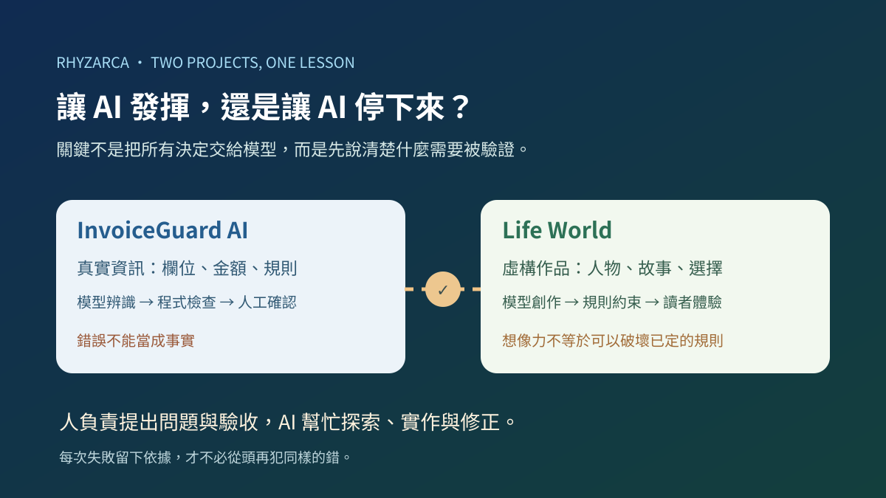

*圖一：左側取材自 InvoiceGuard AI 的小樣本辨識報告，右側以互動旅程象徵 Life World「作品」功能的生成成果。這是兩個專案的概念封面，不是它們已整合成同一套系統的畫面。*

> **TL;DR**  
> 來自不同行業的我們，在有限時間裡與 AI 討論、搜尋、試錯，把行政與 CRM 的需求逐步做成系統。InvoiceGuard AI 協助辨識與審核；Life World 則以目標、經歷與人設為基礎，透過 AI 生成和工程計算產生作品，讓現實安排與虛構創作都有出口。
>
> 文中的三份 HTML 是 Life World「作品」功能的匯出成品，不是使用者自行撰寫的遊戲，也不是產品本身。

---

### 一、兩個 AI 專案的起點，其實都不是 AI

在職涯轉換期間的課程接近尾聲時，我同時參與兩個性質很不一樣的團隊專案。成員來自不同行業，**這不是一群專職工程師事先拿著規格書分工開發的專案**。大家先從各自熟悉的工作情境與痛點開始討論，反覆縮小問題、決定目標，才慢慢找到兩個值得嘗試的方向。

雖然我已有程式開發、資料串接與系統整合的經驗，但這次最難的並不是選一種程式語言，而是**讓不同背景的人對「究竟要解決什麼」取得共識，再把想法縮成有限時間內做得到的功能**。中途也常遇到不知道下一步該怎麼設計、工具接不起來或結果不如預期的時刻。我們不斷與 AI 對話、搜尋資料、動手試作，發現 Bug 再回頭修正；不是一開始就有完整答案，而是在反覆嘗試中逐漸把作品打磨出來。

**InvoiceGuard AI 最初想減少的，是行政人員在發票和客戶之間反覆奔波、確認與等待的時間。** 補件要聯繫客戶，申請或核對發票時不確定法規與公司內部做法，想找人問後續流程，又可能不知道該找哪個窗口。單純把手寫三聯式發票辨識成文字，並不會自動解決這些事。

所以產品需要的不只是 OCR：要能追溯原始資料、記錄人工修正、讓採購與財會知道案件走到哪裡，也希望透過 RAG 知識庫幫不熟悉規定的人找到文件與依據。這些是團隊希望改善的工作情境，**並不是宣稱已實測縮短多少往返或補件時間**。

**Life World 的起點則是業務 CRM 與目標導向紀錄。** 名片、電話、客戶名稱都存下來了，真的就了解客戶想要什麼嗎？每天寫下「今天努力過」，又如何知道目標向前走了多少？

這裡還有一個比功能更難的問題：使用者為什麼願意持續提供自己的生活、偏好與關係資訊？於是團隊提出「作品」的構想：讓目標、日誌與人物資料不只被保存，也能成為規劃、劇場、故事與腳本的素材。**使用者提供需求與素材，由 Life World 背後的 AI API 和工程機制生成內容，再把完成的作品交到使用者手上。**

後來的討論也讓我們看見，需求不一定只來自工作。有人想理解客戶，有人想把孩子的生活寫成故事，也有人想建立一個不存在的世界，讓歷史人物、自創角色或熟悉的虛構人物走進另一種情節。**想像、娛樂與表達，本身也是真實的需求。** 不必交出私人日記，才能開始創作；希望透過作品增加持續記錄意願，則仍是需要驗證的產品假說。

一邊要讓真實發票不能亂猜，一邊要讓有經歷、有個性的人物在作品裡說話、選擇與行動。兩個方向看似不同，最後都回到同一件事：**不能只看 AI 做出了什麼，還要理解這個結果從哪裡來，以及是否符合使用目的。**

#### 我在專案裡負責哪些事？

兩個專案都是團隊共同討論和完成的成果。不同產業背景的成員先提出實際需求，再逐步分擔產品構想、介面、資料、美術與功能測試等工作；遇到不熟悉的領域，就研究、請 AI 協助並交叉核對。InvoiceGuard AI 涉及前台、後台、API、RAG；Life World 則涉及人物、作品、互動體驗與全端整合。Claude、Codex 是協助研究、實作和獨立複查的工具，不能取代團隊自己決定方向與成果取捨。

我的主要投入包含：

- **InvoiceGuard AI：** 規劃三站與 Vercel 部署環境、機密隔離、啟動工具、共用串接模組與契約檢查；參與資料庫、AI 模組和 RAG 的整合與技術審查，並對需要複查的項目設定驗收方向。
- **Life World：** 全端整合、Cloud Run／Cloud SQL 等雲端架構與部署把關、人物與作品資料契約、功能審查；提出部分互動玩法與故事品質修正方向，並要求不同 Agent 對生成與重送問題進行獨立驗證。
- **共同的工作方式：** 先確認這次要解決什麼、哪些操作可以做，再讓 Claude／Codex 等工具研究、實作或找反例；拿到程式版本和測試紀錄後，才決定能否採納與提交。

**負責技術方向、提出反例與驗收，不等於每一行程式都由我親手寫出。** 我會在後面把自己做的決策、團隊成果與 AI 實際執行的部分分開說明。開發時協助我們的 Claude／Codex，和 Life World 在使用者建立作品時呼叫的 Gemini 等產品內 AI 服務，也是不同角色。

#### 30 秒看兩個專案的關鍵技術決策

如果你比較關心工程實作，可以先看以下五個關鍵問題、我參與的處理方向，以及各案例的驗證界線。團隊開發日誌與原始測試資料不作為公開閱讀入口。

**表一：雙專案的技術挑戰、處理方向與驗證界線**

| 專案與問題 | 我參與的決策／協作重點 | 已知結果與限制 |
| --- | --- | --- |
| InvoiceGuard｜合法 JSON，期別仍認錯 | 將模型讀字、程式換算與人工核對分開，檢查內容是否有依據 | 同一樣張曾得到不一致期別；格式正確不代表辨識正確 |
| InvoiceGuard｜B 的預覽卻被 A 的回應覆蓋 | Claude 修正、Codex 以登入轉址、重拍及延遲讀檔等情境獨立找反例 | 以選檔版本與回應有效性檢查避免舊資料覆蓋新檔 |
| InvoiceGuard｜RAG 有來源卻套錯規定 | 核對文件索引、適用情境與資料不足時的回答邊界 | 「發票開錯」與「發票遺失」混淆，促使團隊修正檢索與回答方式 |
| Life World｜選到人物卻未接入正式設定 | 在生成前進行唯讀盤點，限制人物設定來源並鎖定作品版本 | 找出舊角色卡與正式人物資料的差異；後續版本化接入 |
| Life World｜重送可能造成多生成與計費 | 設定不可重複的驗收條件，交由不同 AI 工具反例複查 | 五輪限定案例檢驗；全套測試仍有原有的失敗、錯誤與略過 |

這張表不是把不同日期的測試合成同一個「完成率」；各組證據仍以原始紀錄中的版本、樣本與環境為準。

---

### 二、第一次體會：JSON 長得很正確，數字還是可以錯

行政人員想減少重複登打，但財會不能因為「AI 已辨識」就直接讓資料過關。因此第一個該確認的，不是系統畫面有多漂亮，而是資料到底能不能信。

最先讓我印象深刻的，不是複雜的系統架構，而是一張空白的三聯式發票樣張。

2026 年 10 月 28 日，團隊以 Google Document AI 進行 OCR（光學字元辨識），再讓 Groq 上的模型整理輸出。同一份輸入第一次把「一〇八年九、十月份」回成 `202109`，隔天再次測試，又回成 `201909`。

兩次都是合法 JSON；年份與期別卻不一致。依後續系統採用的「雙月期末月」紀錄方式，這個樣張對應的值應為 `201910`。早期紀錄當時另有不同的對照寫法，不能把它和後來定義好的欄位規則混成一回事。

這個例子讓我重新理解「AI 已經辨識成功」究竟是什麼意思。

**能輸出規定格式，只證明它知道怎麼交卷；不代表答案正確。**

團隊後來的作法，是把工作拆開：讓模型先辨識票面文字，年、月、金額及期別的換算交由程式處理；缺少依據或出現衝突時，保留人工確認。11 月 5 日之後，API 主要發票擷取路徑又改為 Gemini 直接讀取影像，不能再把早期 Document AI → Groq 實驗當成最新實作。

不論模型怎麼換，有一件事沒變：採購人員必須能核對 AI 原始值、修正值，財會也必須有自己的審核權限。這些不是多做幾個按鈕，而是讓錯誤不會一路進入正式流程。

---

### 三、從簡報上的 94.3%，學會問「到底測了什麼？」

報告裡有一張很清楚的比較圖：原始影像的 Zero-shot（不提供示例）辨識，欄位命中率為 74.3%；經過裁切校正、搭配 Few-shot（少量示例）等不同組合後，最高一組達到 94.3%。

如果只看最後那個數字，很容易覺得「準確率已經接近 95%」。但那張簡報底下還有一句更重要的提醒：**這組比較來自五張發票、共 70 個欄位。**

*圖二：依 InvoiceGuard AI 專案簡報第 13 頁重繪的四組比較。74.3%、88.6%、92.9%、94.3% 各有不同輸入條件；樣本僅五張發票、70 個欄位，不能外推為正式系統整體辨識率。*

而且，這裡不只改了一件事：影像裁切校正與 Few-shot 條件也不同，不能把提高的 20 個百分點全部說成某一種技巧的功勞。

專案的另一份測試資料有 100 筆黃金集索引，但其中只有三張有人工逐欄標註。**100 筆索引和 100 張都經過人工標準答案核對，是完全不同的證據。**

這些數字提醒我：做 AI 系統時，除了問模型有多厲害，更要問測試的分母是什麼、誰提供正確答案、條件改了幾項，以及錯誤能否被攔下。

我後來愈來愈在意的不是「報告寫了多少 passed」，而是這些通過結果，究竟可以支持哪一句話。

這個發現沒有讓我否定 OCR 的價值，反而讓整個產品設計更清楚：**AI 原始辨識值應保留下來，人工修改不能悄悄覆蓋來源；採購核對與財會覆核也必須是明確的關卡。** 這些規則與介面在專案中陸續規劃、開發與測試，但不能因此宣稱所有發票從上傳、人工修正到正式核准匯出，都已完成同一版本的端到端驗收。

看清楚統計證據的限制，才能知道哪些風險應留給程式檢查、哪些必須由人確認。

---

### 四、明明已經換成 B，畫面還留著 A；有引用的回答，也可能用錯規則

另一段開發經歷更接近一般使用者的日常。

採購人員上傳 A 發票，接著改選 B。B 的預覽明明已經顯示在畫面上，A 之前那個慢半拍的回覆卻突然抵達，將 A 的辨識欄位蓋到 B 上面。

這不是模型認字準不準的問題，而是兩個非同步工作碰在一起。**畫面上的檔案和旁邊的欄位，如果不是同一張發票，再漂亮的辨識結果也沒有用。**

第一次修正用選檔版本號擋掉舊資料。我接著請 Codex 從不同情境獨立複查，卻又發現：舊的登入轉址可能先發生、手機重拍前舊工作尚未作廢、延遲的讀檔也可能蓋過後選的檔案。Claude 再依這些反例修補，把「現在仍然是同一份檔案嗎？」放到真正改動畫面之前檢查。

這是我喜歡的協作方式：**不是叫兩個 AI 都說一次沒問題，而是讓其中一個故意找出另一個可能沒想到的情境。**

接著，輪到企業知識庫問答出問題。

RAG（檢索增強生成）會先從公司授權的法規、流程文件找資料，再讓模型整理回答。報告裡甚至有「點擊引用編號，回到來源原文」的操作畫面。但一次真正的操作題測試中，AI 把「發票開錯」的處理方式，套用到「發票遺失」上。

它有引用，也不代表用的是正確的規則。對不熟悉規定的新進同仁而言，這種錯誤可能比直接說「我不知道」更危險。

*圖三：依專案簡報的「RAG 回答點開來源」畫面，以及實際操作題失敗紀錄重繪。這是辨識「有引用」與「引用適用」的差別，不是任何發票法規的操作指引。*

團隊重新整理了 OCR 辨識出的條文項次與索引，讓問答分兩輪完成：先產生答案草稿，再比對來源與適用情境；缺乏依據時應明確說資料不足，不必硬給結論。

這裡我看到的不是單純的模型優化，而是產品責任：**真正需要幫助的人，不能因為 AI 很有自信，就被帶往錯誤的下一步。**

---

### 五、Life World：從目標與經歷，建立有個性的人物

同一段時間，我也參與另一個性質很不同的團隊專案——Life World。它後來的故事與遊戲很容易吸引目光，但要理解這個產品，得先看見作品背後的目標、日誌與人物資料。

**Life World 原本從業務 CRM 與目標管理出發，後來逐步連起經歷、人物設定與作品生成。** 有了名片與聯絡日期，仍不一定理解客戶的需求；目標寫在清單上，也不代表每天的努力都能被看見。另一邊，使用者未必願意把私人生活交給系統。填寫是成本，資料如何使用也需要信任，不能靠一句「AI 會幫你分析」解決。

我們因此提出「作品」這個回饋方向：自己願意留下的經歷，可以成為規劃、故事、劇場或腳本的素材。這不只是用一個遊戲吸引人填表，而是希望紀錄真的改變下一次產出的內容。至於能否增加持續填寫與回訪，仍要靠實際使用者驗證，不能以作品完成數代替成效。

#### 目標提供方向，日誌留下做過的事

目標管理要回答「我想往哪裡走，實際做了什麼」，而不是替每篇日誌隨意加分。使用者可以設定學習、工作或創作方向，記下真實行動，再確認這次對目標有多少貢獻。AI 可以協助整理草稿，但不是因為模型說了一句鼓勵的話，事情就算完成。

例如，模擬客戶在作品裡答應合作，不等於使用者真的拿到訂單；使用者看完演練後實際修改提案、完成一次拜訪，才是另一筆可以確認的行動。反過來說，若目標是完成小說，真正寫好並採納一章，就是現實中的創作成果，不能因內容虛構就否定這份努力。

**使用者的真實目標、人物在故事中的動機，以及作品這次要完成的任務，應該分開。** 角色想守住一個秘密，是人設與情節的一部分；使用者想完成一份企劃，才是他自己的目標。日誌也不必每篇都綁定目標，人物資料不必公開，記下一段經歷更不代表必須拿去生成作品。

#### 每個人物都有經歷，虛構人物也不例外

日誌是經歷的入口之一，但「人物經歷」不能只指使用者寫下的真實生活。歷史人物有史料記載的過去，既有虛構人物有原作中的遭遇，自創人物則可以由作者建立身世、關係、成功與失敗。**虛構代表經歷存在於故事設定中，不代表人物沒有過去。**

**表二：同一套人物基礎，可以接住不同來源的經歷**

| 人物來源 | 經歷與人設的素材 | 需要保留的區別 |
| --- | --- | --- |
| 使用者自己 | 生活日誌、工作與學習紀錄、自我描述 | 自己發生過的事、自己的解讀，以及希望在作品中如何被呈現 |
| 其他真實人物 | 互動紀錄、對方提供的資訊、帶有來源的觀察 | 本人說法、旁人印象與 AI 推測不能混為事實 |
| 歷史人物 | 史料、傳記、已知事件與明確標示的補寫 | 考據與不確定性要保留；架空歷史是另設假設，不是改寫史實 |
| 既有虛構人物、自創人物 | 原作情節、作者設定的身世與世界規則 | 原作、二創、平行世界及作者採納的故事版本要分得清楚 |

所以，使用者可以記錄自己和朋友的經歷，也可以建立一位從未存在的人物，替他寫下一段過去。創作一個奇幻世界，不需要先交出私人日記；娛樂、二創、歷史改編與情感表達，本身就有使用價值。

「我」的人設也不是旁觀者的附屬資料。使用者可以選擇讓自己的 Self Persona 參與作品，或建立自定義人物，扮演一個不同身分。人物主檔記錄「是誰」，人設則說明這個版本的他如何理解、說話與選擇；扮演者、演出的角色與採用版本，在產品設計上也需要分清楚。

#### 從經歷到人設，不是替人物貼幾個標籤

如果人設只剩「勇敢、外向、喜歡旅行」，人物仍然容易變成換了名字的同一種角色。更重要的是：**他經歷過什麼，如何理解那些事情，因此重視什麼、害怕失去什麼，遇到衝突又為什麼這樣選。**

舉一個創作上的假設：同樣曾被同伴失約，一位角色把它理解為「承諾不能輕信」，因此習慣確認細節、準備備案；另一位角色卻想「我不希望別人也有這種感受」，所以特別在意守約與照顧同行者。這不是在替真人做心理診斷，而是說明相似經歷可以有不同解讀，不能把一件事機械地換成永久人格標籤。

**經歷與來源 → 對經歷的理解或作者設定 → 價值、動機與關係 → 情境中的語氣、判斷與行動**，才是我希望 AI 與程式共同支撐的人物基礎。AI 協助整理與生成候選描述，使用者可以確認、修改或選擇創作方向；程式管理資料來源、權限、版本與作品使用範圍。這裡說的是整體設計主線，不是宣稱所有經歷已能毫無人工確認地自動變成人設。

例如使用者記下「朋友逛老書店很開心，但到人擠人的夜市想提早離開」，這是一條有情境的觀察，不應直接升格成「他永遠討厭夜市」。等使用者核對、採納進新版設定，下次生成同一人物參與的行程時，書店、趕場與擁擠場所才有更具體的反應依據。**真正要檢驗的是新資料是否帶來合理差異，而不是分數有變就算學會。**

對虛構人物也一樣。作者設定他曾在撤離時與家人失散，於是他在冒險中堅持清點同伴、寧願晚一點出發。讀者即使沒讀到「他重視家人」這句介紹，也能從行動認出這個人。人物在作品中顯得「活」，靠的是這種可延續的理由，不只是多幾句台詞。

#### 畫面選到人物，不代表模型真的拿到對的人設

這條產品主線在實作上也曾遇到缺口：畫面已經能選人物，生成模型卻不一定收到正式設定。早期創作入口主要依賴舊角色卡，和後來整合的人物資料之間還有落差。首篇作品生成前的唯讀盤點因此判定 `NOT READY`，沒有直接把「畫面可選」當成「已接通」。

後續才補上人物的正式來源、版本鎖定與輸入範圍。作品開始時固定使用某一版人設，後來修改人物，不應讓正在生成的同一件作品突然換個個性。規劃階段與角色演出需要的資料也不同，不能把所有人物的完整私人設定一股腦交給每一次生成。

這件事提醒我：**日誌、經歷、人設和作品，不是放在同一個網站就算整合。模型是否實際讀到正確內容，還得追到輸入與保存流程核對。**

同時，真人經歷、旁人的印象、AI 推論與虛構情節仍須分開。作者可以把一場虛構事件採納為角色的故事經歷，延續到下一部作品；但不能把 AI 在劇中說的話寫成真人記憶，或讓虛構冒險自動增加使用者的真實目標進度。

如果朋友看完作品後真的補充「我不喜歡的是中午太熱，不是海邊」，這段真實回饋才可能成為新的紀錄。若是作者選定某個結局作為續作前提，則應保存為該故事世界的經歷，與沒有採用的平行分支區別。這些回流方式需要明確確認，不能用「AI 自動學習」一句話帶過。

---

### 六、「作品」如何生成：規劃、情境與文字創作

**Life World 的功能是生成作品；HTML 是生成後的交付成果。** 使用者不是先自己寫好遊戲，再把檔案交給 Life World。使用者提供需求、選擇人物與相關素材，系統才透過背後的 AI API、規則計算與生成流程，產出相應內容。

這個分工必須從生成一路說到播放，否則只盯著離線檔裡的 JavaScript，很容易漏掉前面已經完成的工作。

**表三：從素材到作品，系統各階段在做什麼**

| 階段 | Life World 處理的事情 | 使用者參與的部分 |
| --- | --- | --- |
| 選擇與準備素材 | 依作品需求組合可使用的經歷、人物設定、版本與情境條件 | 決定題材、人物、素材範圍與希望達成的目的 |
| AI 生成內容 | 依模組生成規劃、人物反應、對話、場景或故事段落 | 提供要求、檢視內容，必要時調整設定或方向 |
| 工程規則與驗證 | 處理可行性、時間、分數、分支、版本、重送與成本等條件；各類作品使用的規則不同 | 決定哪些結果可以採納，哪些仍需修正 |
| 保存、匯出與分享 | 將已保存的作品資料與對應播放器組合，產生可閱讀或操作的 HTML | 下載、閱讀、改選路線或分享，無須自行撰寫網頁 |

**最後的匯出步驟不呼叫模型，不代表作品不是 AI 生成的。** 生成階段已完成內容與必要計算，匯出才把結果和固定版本的播放器打包。播放器也不是每次讓模型臨時重寫一套程式；這樣才能檢驗同一作品版本的規則與重現性。

這裡以日誌、人物經歷和人設為創作基礎，並不表示每次呼叫都會讀取全部資料。有的模組只需要公開簡介，有的需要當前人物的完整設定。已接入的人設生成流程、經歷如何整理與採納，以及使用者是否因此更願意記錄，是不同層次的工作與驗證。

#### 三種生成方向，不只對應現實世界

「實際需求」不等於「只能處理真實生活」。有人想安排下週的旅行，也有人想讓一支虛構隊伍穿越失落城市；有人希望先練習客戶會談，也有人想看歷史人物在架空事件中如何選擇。這些需求可以使用同一套人物基礎，差別在於想得到什麼作品。

**表四：依使用目的區分作品，而不是依 HTML 有哪些按鈕**

| 生成方向 | 核心用途 | 現實與虛構都可以提供題材 |
| --- | --- | --- |
| **規劃型的互動** | 比較安排、限制、備案與不同選擇的影響 | 旅遊、學習、客戶拜訪，也可以是冒險路線、架空城市或故事分支規劃 |
| **情境型的互動** | 把過程變成場景，在關鍵時刻選擇並體驗不同發展 | 行前預演、局部提案、親子故事，也可以是推理、歷史假設、二創或原創世界 |
| **純文字型的小說、腳本** | 形成可閱讀、修改、審稿、排練與改編的文字 | 日誌敘事、影音腳本，也可以是原創小說、歷史改編、番外或角色獨白 |

這是產品用途的分類，不是所有題材都已完成專用模板。現階段的生成內容以文字為主，搭配已實作的互動、場景與特效；下方各放一份系統匯出的代表作品。它們是成果樣本，不是 Life World 只有三個固定頁面，也不能由單一成品推定所有版本、裝置與使用成效均已驗證。

#### 規劃型互動：讓目標、人物與限制形成可以比較的走法

想像要和朋友 A、B、C 安排旅行。只給一張排好的路線表，很難看出換掉一站會怎樣。使用者選好參與人物、提出行程需求後，Life World 先生成候選地點與人物反應，再讓程式處理時間與路線限制。完成的作品可以反覆改選，協助大家討論什麼比較合適，而不是讓 AI 直接宣布所有人都該接受的唯一答案。

**人物的「滿意 +2」，不是在 HTML 裡憑空寫出來的。**

以《海角小鎮一日遊》為例，同樣到了「燈塔步道」，一位角色得到 -1，另一位得到 +2。生成階段的 `game_plan` 先依同行者的公開簡介準備情境與候選內容；`game_reaction` 再分別讀取每位角色鎖定版本的完整人設，產生各站的 `delta`（-2 到 +2）、不同態度下的反應與願望。後端程式檢查可走的路線、時間條件與結局門檻；匯出後，播放器依玩家選擇計算數值、選取已生成的反應與結局，無須每走一步重新呼叫模型。

**先參考人物生成內容，再依工程規則計算，是這份作品的來源；離線播放只是最後一段。** 匯出檔不攜帶完整私人設定，是資料隔離的安排，不能因為玩家看不到人設全文，就說生成時沒有依據。另一方面，使用了人設不等於每一個反應都一定合理，人物與情境是否吻合仍需檢查；分數也不等於真人親口同意。

有意義的改善方式，是在相同情境下比較不同已確認版本的人設：例如加入「喜歡慢慢逛書店、不喜歡時間被塞滿」之後，相關反應是否有合理變化。涉及私人經歷的核對應留在授權範圍內，不必為了向分享對象解釋分數，就把所有原始日誌一起匯出。

**為什麼要多結局、能回頭改選，還要提供下載？**

受限於這次專案的開發時間，我們選擇單一 HTML 作為可離線使用的交付方式，而不是先完成一個多人即時協作平台。系統生成一次後，使用者可以回到前一站改選，立即看見時間、人物反應與結局的改變，也能把同一份作品交給朋友，在不登入、不再次消耗模型額度的情況下比較方案。

每個人在自己的裝置上試不同走法，再透過面對面或通訊軟體討論，直到找出相對能接受的安排。離線檔不會自動同步各人的操作與意見，也沒有替真人完成同意。它提供的是**共同的情境與計算規則**，讓討論不必只停在「我覺得這樣比較好」。

不同結局還搭配不同心情演出：滿意的結果使用煙火或紙花，不理想的結果以雨與褪色呈現；合成音樂預設不播放，由使用者啟動。這些設計讓試玩更有感覺，但特效只是在表達結果，不能當成計算正確或所有人滿意的證據。

**規劃的價值也包含沒有採用的選項。**

既有行程版會顯示候選站點、車程、停留時間，以及打烊或來不及返回起點等限制，也能回頭改選。至於完整保存每個曾考慮但捨棄的可行方案、以及朋友因預算或偏好放棄它的理由，還需要另外的紀錄與確認，不能把「程式判斷來不及」當成所有人的取捨理由。

這個方向不必限於旅行。**在生活與工作裡**，可延伸到家庭活動、購物、登山備案、學習順序、專案安排與客戶拜訪；**在創作裡**，也可以比較虛構冒險隊伍的路線、魔法與補給限制、架空城市的發展，或小說中線索與角色出場的不同順序。歷史背景也能另設假設，探索另一條可能路徑，但要區分史料和創作條件。

上述延伸是應用方向，已核對的第一期行程模組主要完成一日行程題材。新的題材需要自己的資料與規則，不能把一套行程計算直接當成登山安全或所有規劃問題的答案。規劃也不一定要有最高分；有時候，使用者就是想知道另一條走法會帶來什麼不同。

**系統生成作品範例｜《海角小鎮一日遊》**

下面是 Life World「作品」功能的行程互動匯出成果。情境與人物反應在生成階段準備，時間、路線與結果由工程規則處理；讀者現在操作的是這份已生成作品，不是在瀏覽器裡從零撰寫遊戲。

<iframe title="Life World 規劃型互動《海角小鎮一日遊》" src="https://jerrychien1031.github.io/rhyzarca-blog/assets/articles/2026-11-13-two-ai-projects-human-judgment/sea-town-route.html" width="100%" height="560" loading="lazy" referrerpolicy="no-referrer" sandbox="allow-scripts allow-downloads" style="border:1px solid #d2ddd7;border-radius:12px;max-width:100%;background:#fbfaf6;"></iframe>

*規劃型作品：AI 生成的內容與規則計算結果，經系統匯出為可分享、可回溯改選的 HTML。這份虛構範例不代表真人偏好預測。*

[在獨立頁面試玩完整路線](https://jerrychien1031.github.io/rhyzarca-blog/assets/articles/2026-11-13-two-ai-projects-human-judgment/sea-town-route.html)

#### 情境型互動：讓還沒發生，甚至不存在的世界可以被體驗

知道路線，不一定能想像過程。情境型作品把需求展開成場景、人物、對話與事件，於關鍵時刻提供選項，讓讀者體驗換一種做法後可能如何發展。它可以接在一份規劃後面，也可以單獨生成一場對話、一段衝突或一個完全架空的冒險，不必先有行程表。

**這裡的重點，不是把規劃表加上背景圖，而是讓人物帶著自己的經歷與判斷，進入事件。** 同樣遇到阻礙，有人先安撫同伴，有人追問原因，有人立刻找替代方案。模型生成的反應需要符合採用的人設、人物知道的資訊與世界規則；程式則維持選擇條件、狀態與分支的執行。

**原創、二創與歷史假設**都能成為題材。使用者可以讓自創角色探索神祕村莊，從配角角度重新經歷熟悉的故事，也可以把歷史人物放進明確標示的架空事件。歷史記載、原作設定與作者新增的假設應分開，不因模型把場面寫得生動，就把虛構補寫當成史實。

**創作提案**也是實際需求。編輯、編劇與 YouTuber 可以先呈現局部場景：人物怎麼進場、哪一句話帶出衝突、第三個角色介入後會發生什麼，再比較幾種轉折。這份作品是可討論的演出草案，不必等到正式拍攝才發現節奏不成立，也不等於已自動產出完整影片。

**生活與工作**則可以從既有經歷延伸。父母把孩子生活中的片段改編成親子冒險，一起選擇下一步；業務將獲准使用的客戶紀錄與會面目標帶入假想談話，練習面對價格疑慮、需求變更或冷淡回應；教學、面試、客服與跨部門溝通，也能先演一次可能的場面。兒童與客戶的資料仍需要適當權限與分享控制，模擬角色更不等於能預知真人反應。

作品也可以純粹為了娛樂、觀點探索或情感表達。架空世界、寓言、夢境與超現實情境未必有標準答案，有時重點是理解另一個角色，而不是選對選項、取得完美結局。這些是產品可以延伸的用途，不是本期已驗證所有專業模板與情境的宣稱。

《冰下之春》就是一份從城市、冰海走向地下世界的捲動作品。這份匯出內容有 **23 個場景、7 個選擇節點與 4 類結局**，不同抉擇影響後續呈現與人物反應。《空城計》的互動劇情則採另一種演出方式；它的 `play-2` 與《現代鴻門宴》較早的 `play-1` 並非功能完全相同。場景數和結局數描述的是特定成品，不是 Life World 所有作品都固定只能做這麼多。

**系統生成作品範例｜《冰下之春》**

這份 HTML 展示「作品」功能將人物與情境內容、劇情規則及播放器組合後的成果。可以捲動閱讀、在節點做選擇；它不是使用者另寫的一個網頁遊戲，也不是每捲動一次就重新呼叫模型。

<iframe title="Life World 情境型互動《冰下之春》" src="https://jerrychien1031.github.io/rhyzarca-blog/assets/articles/2026-11-13-two-ai-projects-human-judgment/spring-under-ice-scroll.html" width="100%" height="600" loading="lazy" referrerpolicy="no-referrer" sandbox="allow-scripts allow-downloads" style="border:1px solid #d2ddd7;border-radius:12px;max-width:100%;background:#fbfaf6;"></iframe>

*情境型作品：系統生成與匯出的特定成果，包含 23 個場景、7 個選擇節點與 4 類結局。離線重播不抹去生成階段的 AI 與工程工作。*

[全螢幕體驗《冰下之春》](https://jerrychien1031.github.io/rhyzarca-blog/assets/articles/2026-11-13-two-ai-projects-human-judgment/spring-under-ice-scroll.html)

#### 純文字型小說與腳本：讓人物的過去，成為能閱讀與再創作的內容

純文字不是互動作品的簡化版。它的價值在於敘事、對話、動作與結構本身，不要求讀者邊讀邊按選項。使用者選擇人物、相關經歷與創作條件後，「作品」功能透過模型規劃與逐段生成，保存內容與版本，再依需要交付閱讀形式。

**原創小說、二創番外、歷史改編與平行世界**，都可以從人物經歷出發。某個看似固執的選擇，可以在後續揭露原因；同一事件，也可以從幾位角色的視角寫成不同敘述。虛構人物並不缺少經歷，只是他的過去來自作者、原作或已採納的故事，而不是現實日誌。

**小說以外的文字用途**同樣廣泛：短片、舞台劇、廣播劇、YouTube 與 Podcast 腳本，遊戲任務與角色對話稿，人物小傳、世界觀設定、書信或獨白。生活素材也能整理成旅行敘事、家庭故事集或親子共讀內容；忠實整理與自由改編應先說清楚，不為了讓故事更精彩，悄悄替真實經歷加上沒有發生的事。

一份文字作品可以被修改、排練、提案，也能在之後挑出某個場景再做互動演出。三種生成方向沒有固定先後順序，不是一定先有路線、再有場景，最後才能寫成小說。這些延伸用途仍需各自的生成規則與品質檢驗，不能以一份範例代表全部已完成。

**故事生成完了，卻不一定讓人想看完。**

這是我們實作時真正遇到的問題。Life World 已能分段續寫、保存章節與匯出，程式也能檢查欄位、格式及版本；人工讀過後，仍發現人物說話太像、衝突太快解決，甚至有人提前回應還沒發生的事。

於是開始調整提示：讓人物以自己的說話節奏、行為與價值取捨反應，帶入前面已發生的情節，避免續寫改掉前文。我閱讀樣本後，也提出以熟悉的名場面為藍本，讓開場先有衝突與懸念；接著再把做法整理成能跨題材使用的原則，而不是替某篇作品寫死台詞。

Claude、Codex 協助我們研究、修改生成流程與測試；但「這個人物不像他自己」「這裡不會讓我想看下一段」仍需要人親自閱讀、指出差異。特定樣本有改善，不代表跨章時間矛盾與敘事品質都已解決。**有完整的人物基礎，才有條件讓角色一致地表達；用了人設，仍要驗收實際生成的結果。**

**系統生成作品範例｜《現代鴻門宴：會館裡的最後合約》**

這裡使用 Life World 原始匯出的 `play-1` 閱讀作品，包含四幕劇情、場景提示、角色動作與 17 段對話。文字來自系統的作品生成流程，不是為 Blog 另外人工重寫的故事。它以小說敘事與腳本式對話為主，也保留逐段揭開、查看虛構角色情緒與立場的互動閱讀功能；因此這個範例不是無腳本的純文字頁，內容類型與呈現方式要分開理解。

<iframe title="Life World 小說與腳本《現代鴻門宴》原始互動閱讀版" src="https://jerrychien1031.github.io/rhyzarca-blog/assets/articles/2026-11-13-two-ai-projects-human-judgment/modern-hongmen-banquet.html" width="100%" height="560" loading="lazy" referrerpolicy="no-referrer" sandbox="allow-scripts allow-downloads" style="border:1px solid #d2ddd7;border-radius:12px;max-width:100%;background:#fcfaf6;"></iframe>

*小說／腳本作品：Life World 生成的文字內容，以原始互動閱讀器交付。HTML 是作品的載體，不是使用者需要自己製作的功能。*

[獨立開啟《現代鴻門宴》互動閱讀版](https://jerrychien1031.github.io/rhyzarca-blog/assets/articles/2026-11-13-two-ai-projects-human-judgment/modern-hongmen-banquet.html)

#### 從文字走向圖片與影片，人物的基礎不應消失

本期受時間與技術條件限制，先以文字生成、既有場景演出與離線互動交付，不代表 Life World 的想像只能停在 HTML。未來有足夠的製作資源時，人物的經歷、個性與判斷，也可以透過圖片、分鏡、聲音、動畫或影片表達。

例如一位因過去遭遇而對陌生環境保持警戒的人物，文字可以寫他的追問與停頓，圖像可以呈現姿態，影音則能以目光、步伐與語氣增加張力。**媒介可以改變，人物不能因此忘記自己的過去。** 更豐富的畫面還需要人物與場景一致性等製作工作，這是延伸方向，不是本期已完成的影片生成能力。

這三份成品讓讀者看見的是同一條產品主線：以目標與需求決定用途，以經歷與人設建立人物，再由 AI 生成與工程機制產出作品。讀者看到的檔案不是全部功能，卻能作為理解這套系統如何運作的入口。

---

### 七、開發階段的難題：從功能可用到系統可靠

前面的作品能直接閱讀、選擇與回頭嘗試，但真正需要開發的，不只是播放這些內容的畫面，而是**Life World 從資料準備、AI 呼叫、規則計算到作品保存與匯出的整個流程**。任一環節出錯，都可能影響使用者最後拿到的成果。

例如，匯出後的 HTML 不必再連線呼叫模型；但在建立作品時，人物反應、故事內容與互動層仍需要模型生成，也就涉及執行狀態與費用。假設使用者送出請求後網路中斷，按下「再試一次」，系統應該接續或取回原本的結果，而不是又產生一份作品、再計算一次費用。

#### 真正棘手的 Bug，往往發生在兩個步驟之間

Life World 的回合制遊戲便在獨立複查中出現過這類問題：模型已完成生成與結算，但結果還沒存進作品；另一個請求剛好抵達，就可能讓同一位角色再次生成。其他反例包括回應遺失後重送，意外替下一位角色開工；或兩個請求並行，使作品進度從 2/3 多推進到 3/3。

這些狀況不容易從單次正常操作發現。每個畫面可能看起來都對，卻在特定時序下產生重複生成、費用紀錄或作品版本不一致。

我把「**同一個請求重送，不應重複生成或多扣費**」列為必須守住的驗收條件，也要求修正後重新執行既有反例，核對生成次數、費用紀錄與作品版本。Claude 協助處理程式修正，Codex 再從不同的執行順序尋找漏洞；我負責確認驗收要求、檢視交件結果與是否採納。這不代表每一段修補程式都由我親手寫成，而是把人的決策與 AI 的實作、複查工作分清楚。

團隊使用假模型與隔離資料庫環境，刻意讓請求在容易發生競態的時間點碰撞。第五輪在 SQLite 與隔離 PostgreSQL 各通過 **23 個指定案例**，離線播放器另有 **26 項測試通過**。但同輪全套測試仍記錄 **1,142 通過、7 失敗、12 錯誤、35 跳過**；既有失敗和錯誤不能因這次指定案例通過，就從報告裡消失。

這次經驗讓我更重視工程驗收的方式。**修好使用者看見的 Bug，只是第一步；能證明它在中斷、重送與並行操作後仍維持一致，才是系統可靠性的關鍵。**

---

### 八、兩個專案的共同課題：工程判斷、協作與驗收

回頭比較 InvoiceGuard AI 和 Life World，兩者的使用者、資料及產品目的很不同，但開發過程遇到的問題，卻有幾個相似的根源。

**雙專案對照：不同產品裡，相似的工程判斷**

| InvoiceGuard AI | Life World | 共同的工程問題 |
| --- | --- | --- |
| JSON 格式正確，發票期別仍可能辨識錯誤 | 畫面已選人物，生成時卻未必接到正式設定 | **資料有了，不代表來源與內容正確** |
| RAG 有引用，仍可能把規定套到錯誤情境 | 故事完整生成，人物與情節卻可能不一致 | **輸出完成，不等於符合真正需求** |
| 舊發票的延遲回應可能覆蓋新檔案 | 重送生成請求可能造成重複結算或進度錯亂 | **非同步與重試需要明確的狀態邊界** |
| 採購修正與財會核准各有責任 | 人物設定、創作內容與分享權限需要區分 | **AI 可以協助處理，人仍需決定授權與驗收** |

對我來說，這些不只是各自發生的 Bug，也改變了我和 AI 工具協作的方式。面對新需求，我會先釐清使用者真正想解決什麼問題，再定義資料與模組邊界、哪些操作不能出錯，以及最後要用什麼方式確認。

團隊成員帶來的是行政流程、業務互動、人物體驗等各行業的問題與想法；真正開始做時，才會發現要處理前端、API、資料庫、知識庫與部署等不同領域。遇到不懂的部分，我們會一起討論、搜尋並向 AI 提問，再靠實作與測試檢查回答能不能用。

Claude、Codex 可以協助研究、撰寫程式、修正與找反例；但跨 Agent 複查的價值，不在於讓兩個模型互相稱讚，而是**用不同角度提出可重現的失敗情境**。有時 AI 給的答案看似完整，實際操作卻不適合；這時仍要有人把問題說清楚，再決定如何調整。

在 InvoiceGuard AI，前台、管理端與 API 的責任分離，加上部署環境與機密隔離，是為了讓成員能在合理權限內開發與核對資料。在 Life World，正式環境、隔離 E2E 與功能分支必須分清楚，避免把某個測試版本的結果，誤認成所有使用者都已經取得的功能。

另一個共同點，是把適合生成的內容和需要明確規則的部分分開。發票上的文字可以讓模型辨識，換算與審核不能只靠它的信心；故事、人物反應可以由模型生成，版本、路線計算、保存與重送也不能交給它臨場猜測。**想像力和工程規則不是互相抵銷，而是讓作品既有變化，也有能被檢查的基礎。**

這些安排沒有 AI 生成畫面那麼吸引目光，卻直接影響團隊能不能持續開發、交接與修正。**一個功能能跑、能展示，和它已經適合正式使用，是兩個不同階段。** 測試的範圍、未完成的功能，以及仍待驗證的使用者成效，都應該如實保留。

---

### 九、從業務問題出發，我重新理解 AI 應用開發

回想課程尾聲的這段時間，我先想到的不是 FastAPI、PostgreSQL、Gemini、RAG 或 Claude、Codex，而是大家圍繞不同工作痛點反覆討論的過程。**來自不同行業的成員**，從一開始還不知道能做成什麼，走到能實際展示、閱讀、操作的作品；中間沒有一條筆直的路，更多時候是查資料、向 AI 提問、嘗試一種方法，發現不適合再換另一種。

這也重新提醒我：即使有程式與系統整合經驗，真正值得帶走的仍是**從人的問題出發，選擇做得到的方法，再判斷成果是否可信**。工具與模型會更新，但理解需求、處理不確定性及承擔驗收責任，不會因為 AI 更會寫程式就消失。

InvoiceGuard AI 的出發點，不是想證明 OCR 可以讀懂多少欄位，而是減少行政同仁在客戶、發票與內部流程之間反覆確認的麻煩。因此，原始辨識與人工修正要能分清楚，法規問答有來源也必須核對適用情境。

Life World 則讓我看見，**真實需求不只包含提高效率，也包含人想表達、想創作、想看看另一種可能的願望。** 目標讓人知道方向，日誌與人物經歷留下脈絡，人設使角色有可延續的個性與判斷，而「作品」功能把這些素材轉成可以比較、體驗或閱讀的成果。材料可以來自生活，也可以來自歷史、假設、二創與原創世界。

我們要開發的不是幾份固定的 HTML，而是讓 Life World 能根據不同需求與人物資料持續生成作品的機制。至於一份故事是否吸引人、人物是否一致、使用者是否更願意記錄，都還要看實際結果與回饋，不能由功能名稱直接推定。

這兩個專案讓我更加確定：**AI 應用工程不只是串接模型，也包括需求拆解、資料來源與權限、API 與部署、異常處理、跨工具協作，以及能說清楚限制的驗收。**

AI 幫我研究、產生程式與尋找反例；我和團隊成員則提供業務情境、使用回饋、決策與驗收條件。當結果不合理，就回頭核對來源；當程式在重送或並行時失敗，就留下可重現的反例；當功能尚未完成正式驗證，也不因 Demo 能操作就宣稱整個產品已經成熟。

*圖四：兩個專案都需要清楚分工。InvoiceGuard AI 核對真實資訊；Life World 讓 AI 依人物與情境生成內容，再以工程規則管理計算與交付。虛構創作可以自由延伸，但不應混入真實紀錄或破壞作品採用的人設與世界規則。*

這也呼應了我對 Rhyzarca 的一個長期思考：**保留資料還不夠，還要讓後來的人能理解當時為什麼這樣決定、試過哪些方法，以及哪些結果真正驗證過。** 否則即使有大量文件，換了模型或開發者之後，重要的判斷仍可能重新流失。

這段經歷沒有讓兩個專案的所有問題都得到解答。時間有限，過程中也有許多不知所措與來不及完成的部分；但大家從不同行業的經驗出發，靠討論、AI 對話、搜尋和不斷試錯，把起初模糊的想法慢慢打磨成能展示的成果。

**對我而言，AI 的想像力最有價值的時刻，不是它能憑空做出多少東西，而是遇見真實需求之後，讓一群人更有能力把想法往前推；再由人透過判斷、修正與驗收，決定什麼值得留下。**

---

### 🏛️ Epistemic Ledger Entry: #0011

本文公開版只連結已整理為獨立展示頁的互動作品，不提供團隊開發日誌、工程交接、程式庫原件或內部測試報告的公開導航；上述實測限制仍保留在文章中。以下補記保留各次修訂的脈絡，產品定位與展示版本以最後一則補記及當前正文為準。

- **Timestamp:** 2026-11-13T09:00:00+08:00
- **Claim:** 在 AI 參與的真實開發中，允許模型創作或擷取資訊的範圍可因業務不同而改變，但使用者仍須能區分來源、推論、操作副作用與最終驗收。人機協作的價值不只是提高產出速度，更包括辨識錯誤、界定權責，以及讓後續開發者可以重建已確認的理由。
- **Epistemic State:** 個案心得與工程觀察（Case-Based Insight）；並非普遍成效的因果證明。
- **Evidence Scope:** InvoiceGuard AI 依 2026-10-21 至 11-13 的指定 Git、PR 與測試資料；原始簡報四組 70 欄小樣本不代表正式整體辨識率。Life World 的人物、故事與重送問題依功能分支、指定本機／E2E 測試及交接紀錄；四份原始離線 HTML 為作品匯出素材，當前正文嵌入其中三份，不能把不同日期的真實模型試跑與展示樣本混為一談。先前另製的無腳本閱讀整理版已不在正文展示；《現代鴻門宴》使用產品原始互動閱讀版。未重跑兩案完整測試，亦未查驗目前所有正式部署與實際使用量。
- **Dependencies:** 真實授權與責任分工；版本化人物／發票資料；可重新執行的測試與回執；人工確認；跨 Agent 清晰交接；資料安全與作品公開權限。
- **Revision Trigger:** 若後續有更廣泛、獨立且具代表性的辨識黃金集，或公開作品與正式流量完成端到端驗收，應更新成效敘述；若實際部署、授權或內容來源與現有紀錄不同，應保留歷史並修訂當前結論。
- **Next Question:** 當 AI 不只協助寫程式，還能研究、安排與執行，我們要如何讓人的選擇、AI 的實作與獨立驗證形成既不妨礙創造、又能避免錯誤擴散的日常工作方式？

#### 補記：從產品初衷重新理解兩項實作（2026-11-13）

- **補充背景：** InvoiceGuard AI 的起點包含行政往返、補件、公司內部流程與法規諮詢問題；Life World 的初衷則是業務 CRM、目標量化及使用者提供私人資料的心理阻力。以上依本次作者補充的產品背景整理，與早期 Git 測試收據分開看待。
- **補充判斷：** OCR、RAG、互動故事都是因應上述問題提出的手段，不應倒過來把「已開發的功能」當成已解決使用者痛點的證據。尤其以作品提高日誌填寫意願仍屬待驗證產品假說。
- **個人職責界線：** 作者參與全端整合、部署、資料與模組契約、技術決策和驗收，對部分開發任務提出方向與交叉檢驗要求；程式實作、素材及產品規劃由不同團隊成員與 AI 工具分工完成，不將所有成果歸屬單一人。
- **後續驗證：** InvoiceGuard AI 應以經核准的真實業務流程衡量補件、查找規則與人工核對成本；Life World 應在適當隱私與同意機制下觀察是否真的讓使用者願意持續記錄，並以分組樣本和版本化證據呈現，不以展示作品數量代替成效。

#### 補記：角色分數與日誌如何影響人設（2026-11-13）

- **程式可確認的現況：** `game_reaction` 依每位非玩家角色的鎖定版本人物設定，預先生成各站的 `delta` 與反應；離線 HTML 的 JavaScript 只重放選擇、累加分數及判定結局，並非在遊玩當下重新呼叫模型。公開作品不包含完整人物設定，不能從輸出的分數反推確切喜好依據。
- **尚待驗證的問題：** 現有匯出作品缺少各分數可供查核的非敏感理由，也不能證明「日誌 → 使用者確認 → 人物設定修訂 → 新作品反應」已串成完整工作流程。固定分數計算與有來源的個人化判斷，是兩個不同層次。
- **產品假說：** 如果使用者能自願提供經歷、控制資料使用方式，並在後續創作中看見符合人物特質的變化，可能更願意繼續記錄；但沒有日誌填寫率、回訪率與人物反應適切性的比較數據，不能宣稱誘因已奏效。
- **下一步證據：** 使用相同情境與不同的已核准人物設定版本進行對照，核對分數／台詞是否因具體偏好變化而合理改變，同時確認版本鎖定、私人日誌不外洩及舊作品可重現；再以具同意的實際使用者觀察填寫行為是否改變。

#### 補記：離線多結局不是單純的遊戲展示（2026-11-13）

- **作者補充的交付背景：** 受開發時間限制，本期選擇可下載、可單檔離線運作的 HTML；目的不只是增加互動趣味，也希望在不再次呼叫模型的前提下讓參與者共享同一套候選情境，反覆修改路線並討論不同結局。
- **程式能支持的部分：** 第一期間的「一日行程」支援回到前一步、重新選擇、顯示時間與營業限制、按人物預生成的反應重算數值，並依不同結局呈現煙火、紙花、下雨與褪色等演出。可下載 HTML 保留作品的候選內容及計算規則，但每個人的遊玩狀態不會自動跨裝置同步。
- **尚未完成或不應擴大宣稱的部分：** 已知技術性不可行理由與使用者主觀放棄原因不同；完整備案淘汰史、跨使用者即時同步、多人同意與方案採納回執，以及登山、購物、學習或客戶拜訪等題材，均不能以目前第一期行程作品推定已完成。
- **產品假說與驗證方向：** 以可攜式互動作品讓真實參與者比較方案、提出理由與修正偏好，進而更願意提供經歷紀錄。可在取得適當授權後比較多人是否能重建同一條選擇路徑、是否保留未採用理由、討論後能否形成相對可接受的方案，以及這是否真的影響後續日誌填寫。

#### 補記：Life World 作品的三種使用目的（2026-11-13）

- **分類依據：** 作者將 Life World 的作品方向分為「規劃型的互動」「情境型的互動」「純文字型的小說、腳本」。這是依照使用目的提出的分類，不等於三種方向都已有相同的正式驗收或成效。
- **可確認的實物：** `route-1` 展示一日行程的選擇與回溯；`play-1`／`play-2` 展示不同階段的互動閱讀、人物視角與抉擇；`scroll-1` 的《冰下之春》包含 23 個場景、7 個選擇節點與 4 類結局。已有文字生成及小說／腳本匯出程式，但不能將這幾種不同版本直接視為已全面統一的完成品。
- **待驗證的應用方向：** 情境型作品可用於架空世界、編劇與影音提案、親子生活紀錄改編故事，以及客戶拜訪前的模擬討論；尚無證據支持所有專業模板、完整影片產製、實際客戶反應預測或家庭資料保護流程已完成。
- **後續應驗證：** 規劃型的備案及限制、情境型的分支與角色一致性、純文字作品的敘事品質；再以適當授權與實際使用者回饋研究它們是否有助於方案討論、提案、行前準備或持續記錄。

#### 補記：經歷、人設與作品生成的完整脈絡（2026-11-14）

- **本次定位修正：** 依作者確認的說明，Life World 將目標管理、日誌／人物經歷、人設與「作品」功能連在一起。使用者提供需求、選擇人物與素材；AI API 與工程機制生成內容並處理規則；HTML 是系統匯出的成品，不是使用者自行編寫的功能。先前只從 HTML 操作或分數描述產品的說法不足，正文已改從生成流程解釋。
- **人物經歷的範圍：** 使用者自己、其他真人、歷史人物、既有虛構人物與自創角色，都可以有不同來源的經歷。經歷到人設是產品主線，並非認定每筆資料都已自動變成人格結論；真人事實、他人印象、AI 推論與作者設定仍須分層，保留版本與確認。
- **現況與方向：** 既有紀錄支持正式人設接入、版本鎖定、分段生成、角色反應、規則計算與作品匯出。從所有經歷自動更新人設的完整流程、更多題材、參與意願成效及圖片／影片生成，不由這些證據直接推定完成。舊文中「尚待驗證」的範圍，不應被解讀成作品生成時沒有參考人設，或 HTML 是人工寫死的使用者作品。
- **展示與歷史更正：** 當前正文使用三份原始成果：行程互動、捲動情境及《現代鴻門宴》互動閱讀版。先前額外整理的無腳本 reader 展示不是產品原生匯出，已不在正文使用；此處保留這項修訂事實，不改寫原始 HTML。
- **創作與回流邊界：** 真實生活、歷史假設、二創與原創世界都可以構成需求。真人回饋經確認後成為紀錄，作者採納的虛構事件可成為該故事版本的經歷；兩者不能混寫，也不能以模擬結果增加真實業績或進度。圖片、聲音與影片是可延伸的表達形式，人物與世界規則的一致性仍需另行驗證。
