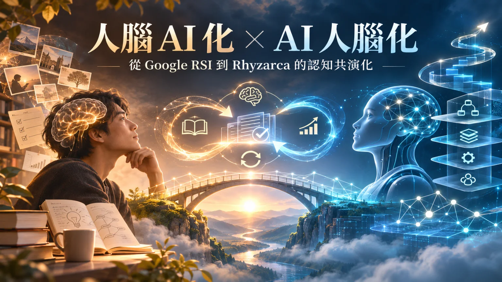
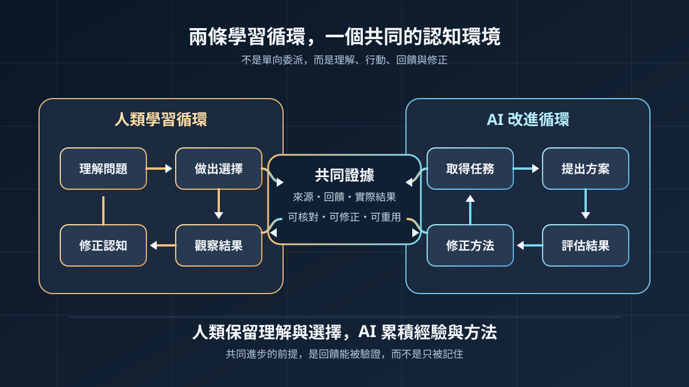

*圖一：人類將部分記憶與分析工作延伸到外部工具，AI 則透過記憶、回饋與自我改進累積能力；兩條路徑在共同的證據與經驗中交會。此圖為原創概念示意，不代表任何研究機構或產品的官方架構。*

> **TL;DR**
> 人腦 AI 化，是人類把記憶、搜尋、分析與規劃延伸到 AI 和外部工具；AI 人腦化，則是 AI 系統逐漸具備可延續的記憶、經驗累積、反思與自我改進機制。兩者不是要互相取代，也不代表 AI 已經擁有人類意識。
>
> Google 研究者提出的 SIM、RRSI、Dream-RSI 與 Harness²，讓我們看見 AI 如何改善產生行動的系統；2027～2028 也可能成為 AI 研究自動化與 AGI 定義受到檢驗的重要窗口，但不同機構的能力門檻與預測差異很大。認知科學則提醒我們，外部記憶能減輕負擔，也可能讓人失去獨立記憶與判斷的練習。真正值得追求的，是人類持續學習、AI 持續改善，兩者透過可查證的回饋一起進步。
>
> *本文討論的是公開研究與作者的長期觀察；Rhyzarca 的部分內容屬未來方向與概念推論，不代表已完成的產品功能或公開工程規格。*

---

### 一、如果 AI 越來越像人，人類又會變成什麼樣子？

想像一個很普通的工作日。

早上，你請 AI 整理昨天讀過的研究，提醒今天要處理的事情，並把幾份文件中的差異列出來。下午，你請它分析一個尚未決定的方案，幫忙模擬不同選擇可能造成的結果。晚上，它還能接續早上的工作，記得你已經排除哪些選項，以及當時為什麼沒有採用。

這時候有兩個問題值得追問。

第一，人類是不是正在把原本由大腦負責的記憶、搜尋、整理、推理與規劃，逐步交給外部工具？第二，AI 是否也正在從一次性的回答工具，變成能記錄經驗、檢查錯誤、改善工作方式，並在下一次任務中延續成果的系統？

我把這兩個方向稱為**人腦 AI 化**與**AI 人腦化**。

這兩個名稱是本文用來整理趨勢的比喻，不是神經科學上的正式分類。人腦 AI 化，不是把人類大腦改造成電腦；AI 人腦化，也不是宣稱模型已經有了意識、情緒或主觀經驗。本文討論的是認知功能與工程機制如何改變，而不是把功能相似直接等同於生物或心理上的相同。

真正有意思的地方在於：人類正在把部分認知工作交給 AI，AI 也開始透過記憶和回饋改善自己的工作方式。當這兩個方向同時發生，人與 AI 的關係就可能從「使用者與工具」，逐漸走向**共同學習、共同調整的認知系統**。

---

### 二、人腦 AI 化：把記憶交給外部工具，不等於把理解也交出去

人類很早就開始把認知能力延伸到身體之外。

紙筆讓我們不必記住所有數字，地圖讓我們不必在腦中完整保存每一條道路，搜尋引擎讓我們可以先記住資料在哪裡，再於需要時取回內容。現在，AI 又把這種外部化推進到摘要、分類、比較、推理與規劃。

1998 年，Andy Clark 與 David Chalmers 在〈The Extended Mind〉提出「延伸心智」（Extended Mind）的哲學主張，探討外部環境是否可能成為認知過程的一部分。這不是說每一個數位工具都自動成為人的大腦，而是提醒我們：認知活動未必只發生在頭骨裡，外部資源也可能在適當條件下參與思考。

[Clark 與 Chalmers：The Extended Mind（1998）](https://www.consc.net/papers/extended.html)

#### 認知外包：工具替我們記住事情

認知外包（Cognitive Offloading）指的是使用外部工具，降低自己必須在腦中維持的資訊量。

例如：

- 把會議時間交給行事曆提醒，而不是靠自己記住。
- 把研究資料交給知識庫保存，需要時再搜尋。
- 讓 AI 比較多份文件，先找出差異與待確認事項。
- 將長篇對話整理成摘要，避免每次都重新閱讀。

這些做法能降低當下的認知負擔，也讓人有更多餘裕處理其他問題。

但它不是沒有代價。

Lauren L. Richmond 與 Ryan G. Taylor 在 2025 年發表於《Nature Reviews Psychology》的回顧指出，認知外包有助於記憶型任務的表現，但如果原本依賴的外部筆記突然無法取得，使用者可能比原本依靠內部記憶的人表現更差。這提醒我們：**外部工具可以提高當下的任務表現，卻不保證使用者同時學會了內容。**

[The benefits and potential costs of cognitive offloading for retrospective information（2025）](https://doi.org/10.1038/s44159-025-00432-2)

#### Biloading：不只把記憶移出去，也讓內外記憶互相補強

2026 年，Nicolas Crozatier 在 Cambridge University Press 的《Memory, Mind & Media》發表一篇關於科技如何延伸人類記憶的回顧，提出一個值得注意的區分：除了 Cognitive Offloading，還有 **Biloading**。

兩者的差別可以這樣理解：

| 方式 | 核心概念 | 生活中的例子 |
| --- | --- | --- |
| Cognitive Offloading | 把資訊交給外部系統，降低內部記憶負擔 | 讓 AI 保存會議紀錄，自己不必背下所有細節 |
| Biloading | 內部與外部資源同時保存或處理資訊，以冗餘方式互相補強 | 自己先理解會議重點，再保存 AI 整理的紀錄，日後互相核對 |

Crozatier 將 Biloading 描述為一種內外記憶的互補策略，可能支持可靠性、自主性與敘事連續性。這是該篇研究提出的概念框架，仍應視為值得進一步驗證的學術觀點，而不是已經獲得普遍共識的標準技術分類。

[An overview of the externalization of memory（2026）](https://doi.org/10.1017/mem.2026.10034)

我認為這個區分很適合拿來思考 AI 時代的學習方式。

例如，讀完一份 AI 整理的研究摘要後，不要只把摘要存進知識庫。可以再用自己的話寫出三件事：研究想解決什麼問題、最重要的證據是什麼、自己仍然不同意或不確定什麼。之後再回到原始論文核對。

AI 幫忙降低搜尋和整理成本；人類仍然保留理解、記憶、質疑與重新解釋的練習。

**人腦 AI 化真正值得追求的，不是讓人類不必思考，而是讓人類把有限的注意力用在更值得思考的地方。**

---

### 三、AI 人腦化：從一次性回答，到能累積經驗的系統

反過來看，AI 也在逐漸取得一些過去需要長期系統設計才能做到的能力。

早期的聊天機器人，主要依賴當次對話提供的上下文。後來出現檢索、外部記憶、工具呼叫、Agent 工作流程與長期任務管理。現在，研究者開始進一步追問：

如果 Agent 執行任務時發生錯誤，它能不能記得錯誤原因？如果修改了工作流程，能不能記錄預期改善與實際結果？換了一個模型或任務後，過去的改進是否還能繼續使用？

這些方向與人腦的記憶功能有一些可供比較的地方，但必須先說清楚：**這是功能類比，不是證明 AI 已經擁有人類的記憶經驗或自我意識。**

可以先用幾種記憶功能理解差異：

| 人類記憶概念 | AI 系統中的功能類比 | 例子 |
| --- | --- | --- |
| 語意記憶（Semantic Memory） | 可檢索的知識與概念 | 保存某項技術的定義、來源與適用條件 |
| 情節記憶（Episodic Memory） | 任務與事件歷史 | 記錄某次任務發生什麼、使用哪些工具、結果如何 |
| 前瞻記憶（Prospective Memory） | 待辦、提醒與未來任務狀態 | 記住某項工作需要在條件成立後繼續 |
| 程序記憶（Procedural Memory） | Skills、工具使用方式與工作流程 | 保存經測試可重複使用的操作方法 |
| 元認知（Metacognition） | 自我檢查、評估與修正機制 | 比較預期結果與實際結果，決定是否修改方法 |

AI 系統不一定真的採用與人腦相同的結構，但這些功能可以協助我們思考：一個能長期工作的 AI，究竟需要保留哪些資訊？

**只記住答案，和記住自己如何得到答案，是兩種不同的能力。**

前者讓 AI 有機會重複使用舊結果；後者則讓它能檢查過去的方法是否仍然適用，甚至知道哪些方法曾經失敗。

這也正是 Google 相關 RSI 研究值得關注的地方。

---

### 四、Google RSI：開始改善的不只是答案，而是產生答案的系統

這裡所說的 Google RSI，並不是 Google 發布的一個單一產品，也不是一套已經證明能無限制自我進化的通用系統。

它指的是 Google Research、Google Cloud AI、Google DeepMind 相關研究人員與學術合作者，在 Agent 自我改進領域提出的數篇研究。這些研究各自處理不同問題，但有一個共同方向：

**當模型本身不變，能不能持續改善包在模型外面的工作系統？**

這個外部工作系統通常稱為 Harness。它可能包含提示詞、工具、記憶、控制流程、上下文管理、任務分工與驗證機制。

也就是說，改善的對象不一定是模型權重，而是模型如何取得資訊、如何使用工具、如何完成任務，以及如何判斷自己是否做對。

#### 1. SIM／CRSI：讓 AI 記住自己如何改進

2026 年 11 月 13 日，研究團隊在 arXiv 發表：

[Self-Improvement Memory Enables Continual Recursive Self-Improvement](https://arxiv.org/abs/2611.18856)

這篇研究提出持續性遞迴自我改進（Continual Recursive Self-Improvement, CRSI），並設計自我改進記憶（Self-Improvement Memory, SIM）。

它關注一個實際問題：假設 Agent 已經花很多輪改善自己的 Harness，後來換了模型或任務，應該帶走什麼？

只帶走程式碼可能不夠。因為程式碼本身不一定能說明：

- 當初為什麼新增這個檢查？
- 這項修改原本想解決什麼問題？
- 修改前預期改善什麼？
- 實際測試後，哪些結果變好、哪些反而退步？
- 當時使用的模型、任務與評估條件是什麼？

SIM 將這些改善經驗依問題整理，讓提出修改的 Proposer 與選擇修改的 Selector 都能參考歷史，再決定保留、修正或淘汰舊方法。

研究在十組獨立 Coding Source Runs 的配對延續實驗中，SIM 相較於只沿用 Harness 的方法，平均提高 2.36 個評分點，九組勝出、一組退步，配對檢定 p = 0.003。

這是特定實驗條件下的結果，不代表所有 Agent 換模型後都能提高 2.36 分，也不代表任何歷史經驗都值得繼承。作者的研究頁亦註明目前沒有公開實作連結。

[SIM 作者研究頁](https://lucasxinyu.github.io/sim/)

#### 2. Harness²：從單次任務改善，走向持續改善工作方法

[Harness²: Recursive Agent Harnessing for an Open World](https://arxiv.org/abs/2610.14224)

Harness² 將遞迴分成兩個層次：

- **Task-level Recursion：**針對當前任務提出、探測及組合 Harness 修改。
- **Harnessing-level Recursion：**將任務中的有效修改與有證據支持的經驗保存下來，供後續任務使用。

它提出 Propose–Probe–Compose 流程：先提出修改，再觀察修改前後的行為差異，最後依據結果組合出新的 Harness。

研究在三個專業 Benchmark、四種模型與 Harness 配置中，報告最高 11.5 分的 WorkBuddy-Bench 提升、4.5 分的 JobBench 提升，以及 LAB Partial Pass Rate 11.8 個百分點的提升。

這些數字只適用於論文所述的模型、任務與評估條件。官方 GitHub Repository 也明確說明，該專案不是正式支援的 Google 產品。

[Google Research：Harness²](https://github.com/google-research/harness2)

#### 3. RRSI：避免 AI 只為了考試而變聰明

[Regularized Recursive Self-Improvement of Agent Harnesses（arXiv v3）](https://arxiv.org/html/2609.24972v3)

AI 自我改進有一個很大的風險：它可能越來越擅長處理已經看過的測試題，卻不一定能處理真正陌生的問題。

這和學生為了考試背答案很像。練習題成績不斷進步，不代表遇到新的問題也能解決。

RRSI 透過限制候選修改的數量與範圍，並加入 Critic 和 Pruner，讓系統檢查某項修改是否只是迎合特定 Benchmark、成本是否過高，或是否已經沒有保留價值。

研究在八個 Benchmark 中評估這個方法。分布外（Out-of-Distribution, OOD）的 JobBench 提高 4.7 分；另一組採用 Gemini 3.5 Flash 的實驗中，用於演化的 Terminal-Bench 2.1 提高 14.1 分。研究也報告，相較於未正規化的演化方法，產出的 Harness 少用了 30% 的 Policy Tokens。

這個研究提醒我們：**自我改進不能只看熟悉的測試成績，也必須看它能否處理沒看過的情境。**

[Google Research：RRSI](https://github.com/google-research/rrsi)

#### 4. Dream-RSI：讓 AI 在歷史探索中預演新策略

[Dream-RSI: Recursive Self-Improvement through Evolving Worlds（arXiv v1）](https://arxiv.org/html/2609.14858v1)

這篇由 Google、Google DeepMind、馬里蘭大學與維吉尼亞大學研究者共同提出的工作，於 2026 年 9 月 14 日提交。它處理的不是「讓模型自己重新訓練自己」，而是一個更窄、但很實際的問題：**AI Agent 能不能從過去探索過的結果中，學會更有效率地探索下一輪？**

Dream-RSI 將流程分成兩個階段：

1. **Online exploration：**目前的 Coding Agent 依照一套探索策略嘗試解題，過程中留下每次嘗試、觀察結果與評估分數，形成 Discovery Tree（探索樹）。
2. **Offline dreaming：**系統把已經走過的探索樹當成可回放的模擬環境，讓大量候選探索策略在歷史結果上重新走不同路徑，利用已保存的結果快速評分；選出較好的策略後，再部署到下一輪真實探索。

這個方法的關鍵，是把原本只用來記錄「做過什麼」的歷史，轉成可以比較「如果當時換一種探索順序，結果會怎樣」的回放環境。由於既有節點的觀察與評估結果已經保存，離線比較不必每次都重新呼叫 Agent 執行昂貴的任務。

但必須精確理解它改進的是什麼：**變動的是探索策略（exploration policy），不是底層模型權重。**官方程式說明也明確指出，Agent、評估器與任務保持固定，只有決定如何分配探索預算的策略會更新。因此，它展示的是受限任務中的「元探索層自我改進」，不是已經能自主設計下一代基礎模型的完整 RSI。

研究在演算法工程、數學最佳化與 GPU Kernel 工程等領域測試八項探索任務。GPU Kernel 的結果包括：VGG16 與 LayerNorm 在達到相近效能時，所需探索世代數分別為固定策略的約 41% 與 56%；ConvDiv 與 ConvMax 則在相近探索預算下，分別達到 2.09 倍與 1.44 倍效能。

在 Lasso 任務中，Dream-RSI 的 Agent 呼叫次數為 317 次，約為 SimpleTES 的 51,200 次的 1/162。Dream-RSI 使用 Gemini 3.1 Pro，SimpleTES 則使用 GPT-OSS-120B。與論文中採用相同模型的 Recursive Fixed Exploration 基線相比，呼叫次數從 550 次降至 317 次，約少 42%。**比較基準不同，數字就不能混為一談。**

[Dream-RSI 官方研究頁](https://dream-rsi.com/)／[Google Research 官方程式庫](https://github.com/google-research/dream-rsi)

這項研究還有一個重要限制：回放環境只包含 Agent 真正探索過的範圍。它可以精確重播已經留下紀錄的節點，卻不能憑空知道尚未探索的世界；若外部條件、評估器或任務本身改變，歷史回放也不能代替新的真實實驗。

因此，我會把 Dream-RSI 視為一個重要的工程訊號，而不是 AGI 已經到來的證明：

- AI 可以從歷史任務中抽取可重用的探索經驗。
- AI 可以在不反覆支付真實執行成本的情況下，比較多種候選策略。
- AI 可以把經過評估的改善策略重新部署，讓下一輪探索更有效率。
- 但它仍然依賴固定的任務、評估器、模型與有限的歷史探索空間。

**這是自我改進循環的一個可觀察、可測量的局部實例；離無限制、開放式的智能爆炸，仍有很長的距離。**

---

### 五、2027～2028：AGI 會不會在這個時間窗口出現？

當越來越多研究開始談論 AI 自我改進，產業領袖也開始公開討論超級智慧，2027～2028 年自然成為一個值得關注的時間窗口。

但我認為，這裡最容易犯的錯誤，是把所有「AI 變得很強」的里程碑都叫作 AGI，再把不同機構提出的日期排成一條看似確定的時間表。

**AGI 並沒有一個所有研究者都同意的單一驗收標準。**能寫程式、能協助研究、能自動完成一個研究團隊的工作、能在幾乎所有認知任務上超越頂尖專家，以及能在所有職業與物理世界任務中取代人類，是不同層次的能力。

#### 先分清楚：AI 研究自動化、AGI 與 RSI 不是同一件事

我會先用四個層次理解這場討論。這是本文為了整理公開預測所建立的分析框架，不是任何研究機構的官方分類。

| 層次 | 能力描述 | 為什麼不能直接等同 AGI／RSI |
| --- | --- | --- |
| AI 輔助研究 | 協助研究者寫程式、整理論文、設計實驗或分析結果 | 人仍負責研究問題、方向與重要判斷 |
| 自動化研究工作者 | 能在明確目標下獨立完成一段研究工作，並產生可檢查結果 | 自動化一部分研究工作，不等於能自主選擇所有研究方向 |
| 超人類 AI 研究者 | 在研究品質、速度與成本上，足以取代或超越頂尖人類研究團隊 | 可能大幅加速 AI 研發，但仍須確認是否形成持續的自我改進閉環 |
| 開放式遞迴自我改進 | AI 能改善研究方法、模型或下一代系統，且改善本身持續加速下一輪改善 | 這才接近一般人所說的強 RSI／智能爆炸，還需要證明改善能持續複利且不被瓶頸限制 |

這四個層次可能互相重疊，卻不是同義詞。尤其 Dream-RSI 證明了有限探索策略可以被反覆改善，不能因此推論模型已經能自主完成整個 AI 研究領域。

#### 2026 年底，幾個值得追蹤的公開時間訊號

**1. Alexandr Wang：超級智慧正在到來，剩下的瓶頸可能已經改變**

Alexandr Wang 近期的公開談話，以及他在 2026 年 11 月 22 日發表的〈Superintelligence is Arriving〉，提出了一個很值得討論的觀點。

Wang 認為，模型的原始智力可能已不再是主要瓶頸；剩下的差距包括領域專業知識（domain-specific know-how）、工程串接與基礎設施（plumbing），以及實驗能力（experimentation）。他進一步主張，模型可能具備自動化 AI 研究的能力，讓 AI 研究本身成為加速 AI 發展的來源。

這個觀點的重要性，不只是預測 AI 何時超越人類，而是指出：**下一階段的瓶頸可能從「模型會不會思考」，轉向「能不能取得專業知識、接上真實系統、執行實驗並驗證結果」。**

但 Wang 同時反對把「AI 超級智慧必然到來」當成放棄人類決策權的理由。他明確表示，不應接受把社會交給 AI 的「handover」，而應建立能讓所有人保有更大自主性與能力的技術。

這是一位產業領導者的觀點與警告，不是已經經過獨立驗證的 AGI 時間預測。例如，近期受到注目的黎曼猜想證明主張由 Levent Alpöge 公開，Lean FRO 記錄了形式化驗證的成果，克雷數學研究所仍將該題列為進行中。即使這是重要進展，單一數學成果也不足以證明 AI 已能在所有科學領域自主研究。

[Lean FRO 大事紀](https://lean-lang.org/fro/about/)／[克雷數學研究所：黎曼猜想](https://www.claymath.org/millennium/riemann-hypothesis/)

[Alexandr Wang 原始文章](https://x.com/alexandr_wang/status/2124636606959345776)／[Fortune 報導](https://fortune.com/2026/11/23/alexandr-wang-meta-superintelligence-arriving-riemann-hypothesis-nasdaq-ai-selloff/)

**2. Anthropic：早在 2027 年初，研究團隊級自動化就可能成為現實**

Anthropic 在 Frontier Safety Roadmap 中表示，他們認為最早在 2027 年初，AI 系統就有可能完全自動化，或大幅加速大型頂尖人類研究團隊的工作；涵蓋的領域包括能源、機器人、武器研發與 AI 本身。

這段話值得重視，但也必須保留原文的兩個限定：

- 它說的是「plausible」（有可能），不是保證會發生。
- 它把「完全自動化」與「大幅加速」並列，後者不代表人類研究者已經完全不需要參與。

這是 Anthropic 為安全準備所提出的情境判斷，不是 AGI 正式發布日期，也不是完整 RSI 已經完成的宣告。

[Anthropic Frontier Safety Roadmap](https://www.anthropic.com/responsible-scaling-policy/roadmap)

**3. OpenAI：2028 年 3 月的自動化 AI 研究員目標**

OpenAI 在 2026 年 9 月 6 日公布的 Research Acceleration 報告中表示，依照內部衡量，他們已達成原先設定的「2026 年 9 月前具備研究實習生能力」目標。OpenAI 對這個階段的定義，是能在研究者指導下完成明確的研究工作，包括原本需要熟練研究人員花費數天的任務。

同一份報告也表示，正朝著 **2028 年 3 月前建立自動化 AI 研究員**的目標前進，讓它在人工監督下協助深度學習與對齊研究。

這裡最重要的不是單純看到 2028 這個日期，而是 OpenAI 把研究自動化當成明確的工程目標，並開始觀察研究者使用 Agent 的工作方式、實驗量與成功率。

但研究實習生的內部里程碑達成，不代表已有一個能獨立主持整個研究計畫的 AI；自動化研究員目標也不等於 OpenAI 已宣稱完整 RSI 將在 2028 年完成。

[OpenAI — Research acceleration: The view inside OpenAI](https://openai.com/index/research-acceleration-view-inside-openai/)

**4. AI Futures Project：2027～2028 年的預測在 2026 年 11 月再次縮短**

AI Futures Project 在 2026 年 11 月 10 日發布 Q3.5 Timelines Update，根據最新的 METR 評估與其他證據，重新調整對超人類 AI 研究員（Superhuman AI Researcher, SAR）與頂尖專家級 AI（Top-Expert-Dominating AI, TED-AI）的預測。

該次更新提出：

- 團隊成員認為 SAR 很可能在 2027 年某個時間出現，前提是沒有重大的人為放慢前沿 AI 開發。
- 團隊估計 TED-AI 在 2028 年以前出現的機率約為 35%～65%。
- 各成員的 TED-AI 中位日期並不一致：Daniel Kokotajlo 約為 2027 年 9 月；Eli Lifland 約為 2028 年 9 月；Brendan Halstead 與 Thomas Larsen 約為 2028 年 4 月；Romeo Dean 約為 2028 年 9 月。

這裡的 TED-AI 是指在幾乎所有認知任務上，至少與人類頂尖專家一樣好的 AI。它是該團隊用來描述 AGI 的一種操作性定義，不等於每一種身體勞動、社會互動與現實世界工作都已經自動化。也要注意，原始〈AI 2027〉的快速發展結局是一條情境路徑：它曾將超人類程式設計師、超人類 AI 研究員與超級智慧分別放在 2027 年的不同月份；那不是所有作者共同承諾的單一日期。2026 年 11 月的 Q3.5 更新，才是後續根據新證據重新調整的預測。

這些預測還有一個共同前提：沒有出現重大、刻意的前沿開發放慢。政策、能源、算力、硬體、實驗資源與安全限制，都可能改變實際時間。

[AI Futures Project — Q3.5 Timelines Update](https://blog.aifutures.org/p/q35-timelines-update-looks-like-the)

#### 不同預測為什麼差距這麼大？

除了 AI 實驗室與研究團隊的時間預測，還有預測市場與大型研究者調查。

| 來源 | 時間訊號 | 代表的意義與限制 |
| --- | --- | --- |
| Metaculus（2026 年 11 月快照） | 弱通用 AI 約 2027-08；一般通用 AI 約 2030-02 | 不同問題定義的群體預測，不能將弱 AGI 日期當成完整 AGI |
| AI Futures Project（2026-11） | SAR 可能在 2027；TED-AI 有 35%～65% 機率在 2028 前出現 | 特定研究團隊的主觀預測，並且假設沒有重大刻意放慢 |
| OpenAI（2026-09） | 自動化 AI 研究員目標為 2028-03 | 企業內部的研發目標，不等於獨立驗證的 AGI 日期 |
| Anthropic（2026-07） | 最早 2027 年初可能自動化或大幅加速頂尖研究團隊 | 安全規劃情境，不是保證發生的預測 |
| AI 研究者調查（2023 年調查、2024 年發表） | 1,714 位研究者對 HLMI 的中位預測為 2047 年；2027 年達成機率約 10% | HLMI 定義為機器在每一項任務上都能比人類工作者做得更好、成本更低；與前述研究自動化里程碑不同 |

這份調查共收到 2,778 名 AI 研究者的回覆，其中 1,714 份用於 HLMI 預測的彙整。受訪者曾在六個頂尖 AI 會議或期刊發表研究。它的預測時間較長，也提醒我們：**AI 研究員自動化、頂尖認知任務超越人類，以及所有職業都能被完整自動化，是不同問題。**

[Thousands of AI Authors on the Future of AI（2024）](https://arxiv.org/abs/2401.02843)／[Metaculus：弱通用 AI](https://www.metaculus.com/questions/3479/dateweakly-general-ai-is-publicly-known/)／[Metaculus：通用 AI](https://www.metaculus.com/questions/5121/)

#### METR 的能力曲線，能否支持 2027～2028 的時間窗口？

METR 在 2026 年 11 月 20 日更新 AI R&D 相關能力評估，指出在其 TH1.1 與 TH2 任務上，AI 能完成的任務時間跨度大約每 3.61 個月翻倍（95% 信賴區間約 2.08～4.94 個月）。

若單純將這個速度往後外推，模型可能在 2027 年 7 月左右，達到該測試集合中 200 小時任務的 50% 成功時間跨度。

這是非常值得關注的進步，但 METR 同時提醒另一個重要問題：以另一種能力指標 MCI（METR Capability Index）觀察公開前沿模型時，研究者沒有看到所有模型整體能力出現明顯加速的充分證據。時間跨度的快速增加，也可能受到任務難度估計、任務選擇與成功門檻的影響。

因此，不能把「任務時間跨度每幾個月翻倍」直接換算成「AGI 一定在某個月份出現」。

Joi Ito 指導、主要由 AI 產出與維護的 RSI 研究報告，於 2026 年 11 月 12 日修訂，也提醒讀者要把「AI 寫出大量程式碼」、「AI 大幅加速 AI 研究」、「AI 能自主完成研究並改善下一代 AI」分開衡量。它認為 2027 年初出現研究團隊級自動化或大幅加速，是值得認真準備的可能性；但這不等於已有公開證據證明完整、無人監督的 RSI 閉環會在同一時間出現。這個區分很重要：**研究自動化可能先於完整 RSI，而能力提升也不會自動解決安全、治理與人類監督問題。**

[Joi Ito — Recursive Self-Improvement at OpenAI and Anthropic（2026-11-12 更新）](https://joi.ito.com/memos/rsi/full.html)

[METR — AI R&D-relevant model capabilities are improving rapidly and are getting harder to measure（2026-11-20）](https://evals.alignment.org/blog/2026-11-20-q4-2026-capability-update/)

#### 我的判斷：2027～2028 值得當成認知與治理的準備窗口，而不是倒數計時器

把這些資料放在一起，我認為可以得出三個比較穩健的判斷：

1. **AI 研究自動化很可能在 2027～2028 年成為更具體的產業議題。** 不論最後是否達到完整 AGI，研究工作本身已經開始被 AI 介入，而且企業已經設定自動化研究員的目標。
2. **2027～2028 年可能出現跨越現有研究門檻的系統，但時間與能力範圍仍有高度不確定性。** 這個窗口值得提前準備，不應當成已經確定的歷史事件。
3. **即使超級智慧真的到來，也不代表人類必須交出社會決策權。** 技術能力、公共政策、價值判斷與責任歸屬是不同層次的問題。

我特別認同 Alexandr Wang 所提出的警告：如果 AI 逐漸具備自動化 AI 研究的能力，人類更需要思考誰決定研究方向、哪些目標可以被最佳化，以及誰有權拒絕不合理的結果。

**AI 可以擴大人類的認知能力，也可以改善自己的工作方法；但人類不能因此放棄決定社會要往哪裡走的權利。**

這也讓本文的核心命題更清楚：人腦 AI 化與 AI 人腦化，並不是單純的技術競賽，而是人類與 AI 如何在能力差距持續變化的環境中，仍然維持相互校正與共同決策的問題。

---

### 六、人與 AI 的學習循環，如何真正接在一起？

如果只看 AI 自我改進，可能會忽略一件事：**人類也必須在合作中學習。**

AI 幫人類整理資訊，不代表人類就理解了；AI 能根據過去任務改善工具，也不代表它知道使用者真正重視什麼。

2026 年發表於《Proceedings of the National Academy of Sciences》（PNAS）的一篇研究，重新分析了 74 項人機協作研究，探討人類學習如何影響 Human–AI Synergy（人機協同效益）。

研究指出，許多過去的實驗沒有充分提供參與者結果回饋。重新分析後，研究者觀察到：有結果回饋的研究，協同效益傾向較高；當 AI 解釋與結果回饋同時存在時，結果也呈現較正向的趨勢。相反地，只有 AI 解釋、沒有結果回饋的情境，協同效益可能偏負面。

但這是對既有研究的重新分析，不能直接當成已經證明的因果定律。作者也指出，需要進一步直接操弄學習機會的實驗，才能建立更強的因果結論。

[Human learning is an understudied but promising lever for boosting human–AI synergy（PNAS, 2026）](https://doi.org/10.1073/pnas.2536100123)

這項研究對我很有啟發。

假設 AI 建議某個方案，使用者採納後，結果卻不如預期。如果系統只把「AI 建議過這個方案」保存下來，沒有記錄實際結果，人類和 AI 都可能在下一次重複犯錯。

反過來，如果使用者能看到：

1. AI 當時為什麼提出這個建議。
2. 使用者為什麼選擇採納或拒絕。
3. 後來實際發生什麼。
4. 原本的預期與實際結果有什麼差異。

那麼人類可以學會何時應該相信 AI、何時應該自己判斷；AI 也能根據回饋修正未來的工作方式。

這會形成兩條互相影響的循環：

**人類學習循環：**

理解問題 → 看見 AI 的解釋 → 做出選擇 → 觀察結果 → 修正自己的理解。

**AI 改進循環：**

取得任務 → 提出方案 → 執行與測試 → 比較預期與結果 → 修正工作方法。

兩者之間還需要一個共同的回饋環境，保存可以核對的來源、實際結果與適用條件。

*圖二：人類透過理解、選擇與結果回饋更新自己的認知；AI 透過記憶、評估與修正改善工作方法。共同的證據與實際結果，讓兩條循環不只是各自運作，而能互相校正。*

這才是我認為更值得追求的人機協作：不是 AI 每次都替人類做完事情，而是每次合作都讓人類更懂得判斷，也讓 AI 更能處理下一次任務。

---

### 七、從 Rhyzarca 的公開思考方向，看認知共演化可以往哪裡走

Rhyzarca 過去的文章曾討論一個問題：當 AI 越來越強，真正重要的是否仍然只是模型有多聰明？還是人類能不能保留自己的理解、經驗與選擇？

在〈從未知開始〉中，我曾討論人與 AI 如何從模糊需求出發，在研究、操作、回饋與驗證中逐步找到真正的問題；在〈數位巴別塔〉中，則進一步討論當 AI 成為知識的主要翻譯者，人類如何保留回到證據、重新理解與重新解釋的能力。

這次把 Google RSI 與認知科學放在一起，我認為未來可以從三個公開方向繼續思考。

#### 1. 人類的認知增強：不只取得答案，也要保留自己的理解

AI 可以替人類整理資訊，但不應讓使用者只能接受一份無法追溯的結論。

比較好的體驗，應該讓使用者能看見來源、理解不同方案的取捨、提出反例，並在結果出現後回頭檢查自己的判斷。

例如，AI 幫忙整理一份投資研究，使用者不只看到推薦標的，也能看到支持與反對的證據、尚未確認的前提，以及自己的風險承受能力如何影響最後決定。

這樣的工具不只是幫人記住更多資料，也能協助人類建立自己的理解。

#### 2. AI 的經驗延續：不只保存對話，也要保留改善的依據

一般的對話記憶，常常只保存「上次談過什麼」。但如果 AI 要持續改善工作方式，還需要知道哪些方法曾經成功、哪些曾經失敗、當時的條件是什麼，以及為什麼後來修改。

SIM／CRSI 提供了一個值得研究的方向：讓 AI 保留改善經驗，而不是只保存最後採用的程式或答案。

但這也需要避免另一種錯誤：過去有效的方法，不代表現在仍然適用。模型、任務、資料與外部條件改變後，舊經驗應該重新檢查，而不是直接當成規則。

#### 3. 人機共同演化：讓人類的回饋也能改善 AI

人類的價值不只是批准 AI 的工作。

使用者能提供 AI 無法單靠公開資料取得的現場情境、價值取捨、實際結果與新的問題。AI 則能將這些回饋整理成可檢查的知識，改善下一次的分析與執行方式。

這不是要求人類每天都要替 AI 評分，而是讓重要的決策與結果有機會形成可重複使用的經驗。

這三個方向是根據公開研究與 Rhyzarca 既有公開文章推導出的長期思考，不是目前產品功能清單，也不是未公開工程規劃的技術說明。

**我期待的不是讓 Rhyzarca 成為另一個更會回答問題的 AI，而是持續思考如何讓人類與 AI 都能從每次合作中學到東西。**

---

### 八、認知共演化也有風險：人類可能失去判斷，AI 也可能越學越偏

人腦 AI 化與 AI 人腦化聽起來像是雙贏，但兩個循環都可能走向錯誤。

**第一，人類可能過度依賴外部記憶。**

如果所有資料都交給 AI 保存，使用者可能逐漸只記得「去哪裡問」，卻不再理解內容。當平台停用、資料遺失或 AI 回答錯誤時，就缺乏重新判斷的能力。

**第二，AI 可能把錯誤記憶當成經驗。**

如果一次錯誤的診斷被寫入長期記憶，後續任務可能反覆引用。記憶不是事實，檢索命中也不是驗證成功。AI 必須能追溯來源、保留反例，並在條件改變時重新評估。

**第三，AI 可能只學會迎合評分標準。**

RRSI 研究正是針對這類風險，透過限制候選修改與改善選擇機制，降低只對已知測試最佳化的問題。但即使有獨立測試，也不代表所有陌生情境都已被涵蓋。

**第四，人類與 AI 可能形成彼此強化的同溫層。**

如果人類只採納符合自己偏好的答案，AI 又只根據這些被採納的結果改善，雙方可能越來越少接觸不同觀點。這不是共同進化，而是共同收窄。

**第五，記憶延續不等於意識延續。**

即使 AI 可以讀取過去的任務紀錄、使用者偏好與自我改進歷史，也只能說它能在資訊與功能上接續工作。這不足以證明新模型與舊模型具有相同的主觀經驗，更不能直接宣稱 AI 已經形成與人類相同的自我。

因此，認知共演化不能只追求記憶更多、任務更快或自動化程度更高。還必須保留獨立驗證、反例探索、資料權限與人類的否決能力。

---

### 九、怎麼知道我們真的在共同進步，而不是單純更依賴 AI？

如果未來要評估人腦 AI 化與 AI 人腦化是否真的產生正面效果，我認為不能只看 AI 的 Benchmark，也不能只看使用者覺得方便不方便。

至少要分成三個層次。

| 評估對象 | 應該觀察什麼 | 可以怎麼測試 |
| --- | --- | --- |
| 人類認知 | 是否更理解問題、能辨識錯誤、保留知識並遷移到新情境 | 暫時不提供 AI 協助，觀察能否獨立解釋或處理相似任務 |
| AI 系統 | 是否能正確使用過去經驗、適應新模型與新任務、避免重複失敗 | 使用未參與優化的任務或不同模型，與不使用歷史經驗的基線比較 |
| 人機整體 | 是否比人類單獨或 AI 單獨更好，且不犧牲人的自主性 | 比較任務品質、錯誤率、時間、成本、信任校準與使用者的決策參與程度 |

這裡有一個我特別重視的測試：

**當 AI 暫時不能使用時，人類是否仍然比合作前更有能力？**

如果答案是肯定的，代表 AI 不只替人類完成工作，也可能讓人類在過程中學會了新的判斷方法。

另一個測試則是：

**當模型換了、工具換了，AI 是否仍能根據過去有證據支持的經驗，正確處理新任務？**

如果答案是肯定的，代表 AI 不只保存了大量對話，而是有能力將經驗轉化成可重用的方法。

最後還要問：

**人類與 AI 合作後，是否真的比兩者各自工作更好？**

如果只是 AI 產出更多、人類花更少時間，但使用者已經無法判斷結果對不對，那未必是正向的共同演化。

真正值得追求的，是人類保有理解、選擇與修正的能力，AI 也能在證據與回饋中持續改善，兩者合起來產生更好的結果。

---

### 十、結語：人不必變成模型，模型也不必變成人

回到最初的兩個問題。

人腦 AI 化，代表人類逐漸將記憶、搜尋、分析與規劃延伸到外部工具。這能擴大人的能力，但不能讓人失去理解、判斷與重新學習的機會。

AI 人腦化，代表 AI 系統開始具備更完整的記憶、經驗累積、反思與自我改進機制。這能讓 AI 不必每次都從零開始，但記憶與自我改進仍然需要證據、測試與獨立評估。

兩者真正交會的地方，是人類的學習與 AI 的改善開始互相影響。

人類提供價值、目標、現場經驗與選擇；AI 提供知識整理、分析、模擬與可重複使用的能力。每次合作後，人類更了解問題，AI 也更清楚哪些方法在什麼條件下有效。

**人腦 AI 化，不是把自己的思考交出去；AI 人腦化，也不是替模型創造一個人類靈魂。**

我認為未來真正有價值的，是建立一種讓人類持續學習、AI 持續改善，並且能從共同經驗中不斷修正彼此的人機認知關係。

如果說過去的競爭是誰擁有更聰明的模型，那麼未來值得關注的問題，可能會變成：

> **誰能讓人類與 AI 在長期合作中，一起變得更有能力，而且不必犧牲任何一方的自主性？**

這才是我想從 Google RSI 延伸到 Rhyzarca 的認知共演化命題。

*圖三：人與 AI 從每次合作的結果中學習，把經驗帶進下一次探索；往哪裡走，仍由人判斷。*

---

### 🔗 認知脈絡與延伸閱讀

**認知科學與人機協作**

- [Clark & Chalmers — The Extended Mind（1998）](https://www.consc.net/papers/extended.html)：延伸心智的經典哲學論述。
- [Crozatier — An overview of the externalization of memory（2026）](https://doi.org/10.1017/mem.2026.10034)：科技如何延伸語意、情節與前瞻記憶，並提出 Cognitive Offloading 與 Biloading 的區分。
- [Richmond & Taylor — The benefits and potential costs of cognitive offloading（2025）](https://doi.org/10.1038/s44159-025-00432-2)：認知外包的效益與失去外部記憶時的潛在代價。
- [Berger et al. — Human learning is an understudied but promising lever for boosting human–AI synergy（PNAS, 2026）](https://doi.org/10.1073/pnas.2536100123)：結果回饋、人類學習與人機協同效益。

**Google 與其他研究機構的 RSI 研究**

- [Self-Improvement Memory Enables Continual Recursive Self-Improvement（SIM／CRSI）](https://arxiv.org/abs/2611.18856)
- [Harness²: Recursive Agent Harnessing for an Open World](https://arxiv.org/abs/2610.14224)
- [RRSI: Regularized Recursive Self-Improvement of Agent Harnesses（arXiv v3）](https://arxiv.org/html/2609.24972v3)
- [Dream-RSI: Recursive Self-Improvement through Evolving Worlds（指定 v1 HTML）](https://arxiv.org/html/2609.14858v1)
- [Dream-RSI 官方研究頁與實驗結果](https://dream-rsi.com/)
- [Google Research 官方 Dream-RSI 程式庫](https://github.com/google-research/dream-rsi)

**2027～2028 AGI、AI 研究自動化與治理**

- [Alexandr Wang 對超級智慧與 RSI 的觀點影片](https://www.youtube.com/watch?v=_9MXea8z2ps)
- [Alexandr Wang — Superintelligence is Arriving（X 原文）](https://x.com/alexandr_wang/status/2124636606959345776)
- [AI 2027 — Original scenario and timelines](https://ai-2027.com/)
- [Fortune — Meta AI chief Alexandr Wang warns “superintelligence is arriving”](https://fortune.com/2026/11/23/alexandr-wang-meta-superintelligence-arriving-riemann-hypothesis-nasdaq-ai-selloff/)
- [TheWrap — Meta AI Chief Warns Against Handing Over Society to Artificial Superintelligence](https://www.thewrap.com/industry-news/tech/meta-ai-officer-superintelligence-warning/)
- [Anthropic — Frontier Safety Roadmap](https://www.anthropic.com/responsible-scaling-policy/roadmap)
- [OpenAI — Research acceleration: The view inside OpenAI](https://openai.com/index/research-acceleration-view-inside-openai/)
- [AI Futures Project — Q3.5 Timelines Update（2026-11-10）](https://blog.aifutures.org/p/q35-timelines-update-looks-like-the)
- [METR — AI R&D-relevant model capabilities are improving rapidly and are getting harder to measure（2026-11-20）](https://evals.alignment.org/blog/2026-11-20-q4-2026-capability-update/)
- [Joi Ito — Recursive Self-Improvement at OpenAI and Anthropic（2026-11-12 更新）](https://joi.ito.com/memos/rsi/full.html)
- [Thousands of AI Authors on the Future of AI（2024）](https://arxiv.org/abs/2401.02843)
- [Metaculus：弱通用 AI 與一般通用 AI 的預測題目](https://www.metaculus.com/questions/?has_group=false&main-feed=true&order_by=-rank&search=general+ai&status=active)

**Rhyzarca 既有公開文章**

- [從未知開始：當 AI 自行組織專業、擴充工具，與人類共同長出需求](https://blog.rhyzarca.com/2026/11/human-ai-mutual-growth.html)
- [數位巴別塔：當 AGI 成為文明唯一的翻譯器，Rhyzarca 如何保存人類的可理解性？](https://blog.rhyzarca.com/2026/09/agi-rhyzarca_0615099013.html)
- [當 AGI 成為文明的公共大腦：Rhyzarca 為何能夠存在？](https://blog.rhyzarca.com/2026/09/agi-rhyzarca_0627294882.html)

---

### 🏛️ Epistemic Ledger Entry: #0012

- **Timestamp:** 2026-11-28T03:59:00+08:00
- **Claim:** 人類透過外部工具擴充記憶、搜尋與分析能力，AI 系統則透過記憶、回饋與 Harness 自我改進累積可重用能力；若能讓人類學習與 AI 系統改善互相校正，可能形成比單獨使用任一方更有價值的人機共同認知系統。2027～2028 是值得觀察 AI 研究自動化、超人類 AI 研究員與不同 AGI 門檻的高影響時間窗口，但不構成必然到達 AGI 或完整 RSI 的預言。
- **Epistemic State:** Tentative Hypothesis；認知外部化與 Agent Harness RSI 有公開研究支持，但「長期人機共同演化」仍是需要進一步驗證的整合性命題。
- **Evidence Scope:** 依據 Extended Mind 哲學論述、2025–2026 年認知外包與人機學習研究，以及 SIM／CRSI、Harness²、RRSI、Dream-RSI 等公開預印本與研究專案；另納入 Anthropic 研究自動化安全路線圖、OpenAI 自動化研究員目標、AI Futures Project 2026 年 11 月預測更新、METR 2026 年 11 月能力評估、Metaculus 群體預測與 2023 年 AI 研究者調查。不同來源對 AGI、AI 研究自動化、RSI 的定義與時間條件不同，本文不將其數字合併比較；也未獨立重現各研究實驗。Alexandr Wang 的觀點屬產業領袖公開論述，不是獨立能力評估。
- **Dependencies:** 外部記憶可取得且有來源；AI 解釋能搭配可靠的結果回饋；人類保留獨立判斷與拒絕能力；AI 改進使用獨立評估與未見任務檢查；模型記憶不被誤認為主觀意識。
- **Revision Trigger:** 若後續實驗顯示外部認知工具長期降低人類的知識遷移能力，或 AI 的歷史經驗無法改善未見任務、反而加劇偏誤，則應修訂本文對共同演化的正面假設。若 2027～2028 年 AI 研究自動化、超人類研究能力或 AGI 的公開驗收標準與目前預測明顯不同，也應保留預測原貌並追加修訂分錄，不以新結果抹除當時的估計。
- **Next Question:** 如何設計長期、可重複的實驗，同時測量人類的認知成長、AI 的跨任務改善，以及兩者合作後是否真正產生協同效益？當 AI 開始參與 AI 研究本身，誰決定研究方向、風險門檻與社會採用條件？